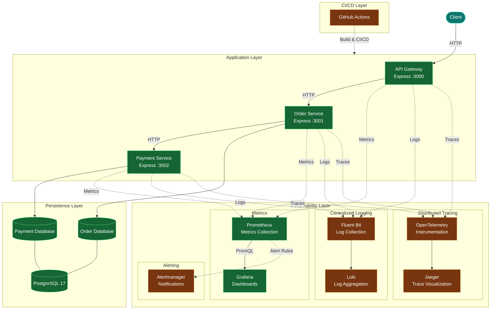
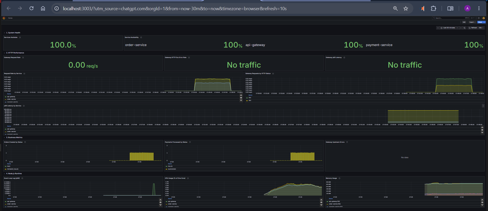
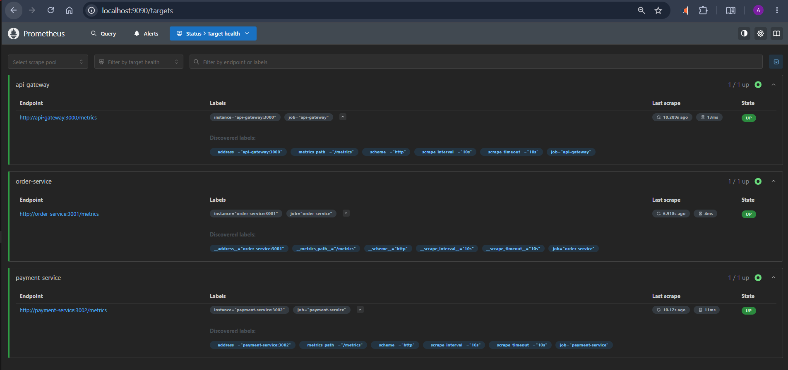

# PulseTrace

**Microservices platform with end-to-end observability foundations.**

PulseTrace is a hands-on project that simulates an e-commerce workflow across independent Node.js services. It explores how to build, containerize, monitor, and troubleshoot a distributed application using modern backend and DevOps tools.

---

## Overview

The application consists of three services:

- **API Gateway** — the entry point for client requests.
- **Order Service** — handles order creation and persistence.
- **Payment Service** — processes simulated payments.

Each service has its own PostgreSQL database. The application runs locally using Docker Compose, with Prometheus and Grafana providing metrics collection and visualization.

The project introduces observability capabilities progressively, building from structured logs and metrics toward distributed tracing, centralized logging, and alerting.

---

## Architecture

The following diagram illustrates the current application architecture and the planned evolution of its observability and CI/CD capabilities.

Implemented components are distinguished from planned components to provide a clear view of the project's current state and target architecture.



**Architecture Legend:**

- Green — Implemented components.
- Amber with dashed borders — Planned components.

### Request Flow

1. The client sends an HTTP request to the API Gateway.
2. The Gateway forwards the request to the Order Service.
3. The Order Service communicates with the Payment Service.
4. Each service interacts with its own database.
5. Request IDs are propagated across services to correlate structured logs.

### Metrics Flow

1. Each application service exposes a Prometheus metrics endpoint.
2. Prometheus periodically scrapes metrics from the services.
3. Grafana queries Prometheus using PromQL.
4. The provisioned dashboard visualizes application and service-level metrics.

Only the API Gateway is exposed as the application entry point. Internal services and databases communicate through the private Docker Compose network.

---

## Project Status

The project is being developed incrementally.

| Component | Status |
|---|---|
| API Gateway, Order Service, Payment Service | Implemented |
| PostgreSQL persistence — database per service | Implemented |
| SQL database migrations | Implemented |
| Docker images and Docker Compose | Implemented |
| Container health checks | Implemented |
| Structured JSON logging | Implemented |
| Request ID correlation across services | Implemented |
| Prometheus metrics from all services | Implemented |
| Provisioned Grafana dashboard | Implemented |
| Unit, API, and end-to-end tests | Implemented |
| Docker/PostgreSQL integration tests | Implemented |
| Logging correlation and metrics tests | Implemented |
| Centralized logging with Loki and Fluent Bit | Planned |
| Distributed tracing with OpenTelemetry and Jaeger | Planned |
| Alerting with Alertmanager | Planned |
| CI/CD with GitHub Actions | Planned |

---

## Observability

PulseTrace currently includes a metrics collection and visualization stack.

**Implemented components:**

- **Prometheus** — collects metrics from the application services.
- **Grafana** — provides a provisioned dashboard for monitoring the system.
- **Structured Logging** — services emit structured JSON logs.
- **Request Correlation** — request IDs help follow a request across service boundaries.

### Grafana Dashboard

The Grafana dashboard provides a visual overview of the application's metrics.



### Prometheus Targets

Prometheus Targets shows the scrape status of the configured application services.



### Planned Observability Extensions

The next observability stages will introduce:

- Centralized log aggregation using Loki and Fluent Bit.
- Distributed tracing using OpenTelemetry and Jaeger.
- Alerting and notification workflows using Alertmanager.

For more details, see [Observability Architecture](docs/architecture/observability.md).

---

## Technology Stack

### Implemented

| Category | Technologies |
|---|---|
| Backend | Node.js 24, Express 5 |
| Database | PostgreSQL 17 |
| Containerization | Docker, Docker Compose |
| Logging | Pino |
| Metrics | prom-client, Prometheus |
| Visualization | Grafana |
| Testing | Node.js Test Runner, Supertest |

### Planned

| Category | Technologies |
|---|---|
| Centralized Logging | Loki, Fluent Bit |
| Distributed Tracing | OpenTelemetry, Jaeger |
| Alerting | Alertmanager |
| CI/CD | GitHub Actions |

---

## Quick Start

### Prerequisites

- Docker
- Docker Compose v2

### 1. Configure Environment Variables

```bash
cp .env.example .env
```

Update `.env` with the required local configuration and passwords.

### 2. Start the Application

```bash
docker compose up -d --build
```

Verify the API Gateway:

```bash
curl http://localhost:3000/health
```

### 3. Create an Order

```bash
curl -X POST http://localhost:3000/api/orders \
  -H "Content-Type: application/json" \
  -d '{"customerId":"customer-123","amount":1500,"currency":"EGP"}'
```

### 4. Start the Observability Stack

```bash
docker compose \
  -f docker-compose.yaml \
  -f docker-compose.observability.yaml \
  up -d --build --wait
```

### 5. Access the Monitoring Tools

| Tool | URL |
|---|---|
| Grafana | http://localhost:3003 |
| Prometheus | http://localhost:9090 |

Grafana credentials:

- Username: `admin`
- Password: `GRAFANA_ADMIN_PASSWORD` from `.env`

---

## Request Correlation Example

Send a request with a specific request ID:

```bash
curl -s -X POST http://localhost:3000/api/orders \
  -H "Content-Type: application/json" \
  -H "x-request-id: demo-1" \
  -d '{"customerId":"customer-123","amount":1500,"currency":"EGP"}'
```

Then inspect the logs across all three services:

```bash
docker compose logs --no-log-prefix \
  api-gateway order-service payment-service \
  | jq -R -c 'fromjson? | select(.req.id == "demo-1") | {time, service, msg}'
```

This demonstrates how a single request can be followed across multiple services using a shared request ID.

---

## Testing

PulseTrace includes several levels of automated testing:

- Unit tests
- API tests
- End-to-end workflow tests
- Docker/PostgreSQL integration tests
- Logging correlation tests
- Metrics tests

See the [Testing Guide](docs/guides/testing.md) for commands and details.

---

## Documentation

For a deeper look into the project:

- [Documentation Index](docs/README.md)
- [Architecture Overview](docs/architecture/architecture.md)
- [Observability Architecture](docs/architecture/observability.md)
- [API Contracts](docs/api/api-contracts.md)
- [Error Handling](docs/api/error-handling.md)
- [Running Locally](docs/guides/running-locally.md)
- [Testing Guide](docs/guides/testing.md)

---

## Project Goals

PulseTrace is designed as a practical learning project to explore:

- Microservices communication and service boundaries.
- Containerization and local orchestration.
- Database-per-service architecture.
- Structured logging and request correlation.
- Metrics instrumentation and monitoring.
- Observability-driven troubleshooting.
- Progressive adoption of DevOps practices.

**The goal is to understand not only how to build a distributed application, but also how to observe and troubleshoot it.**
