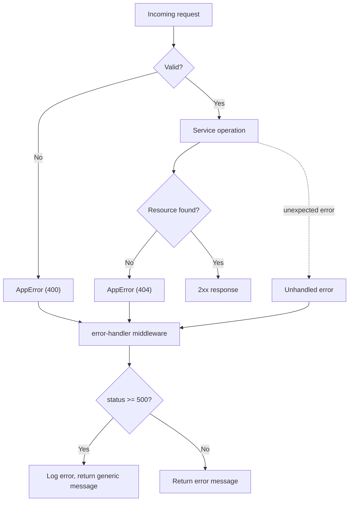

# Error Handling Strategy

## 1. Overview

This document describes the error handling behavior currently implemented across PulseTrace services.

The objectives are to:

- Return consistent error response structures.
- Use appropriate HTTP status codes.
- Avoid exposing internal implementation details.
- Handle communication failures between dependent services.
- Distinguish business outcomes from technical failures.
- Preserve the order state when a payment result cannot be confirmed.

The implementation uses synchronous REST communication and PostgreSQL persistence (one database per service).

## 2. Error Response Structure

The Order Service and Payment Service use the following error response structure:

```json
{
  "error": {
    "code": "INVALID_AMOUNT",
    "message": "Amount must be a positive number."
  }
}
```

The API Gateway uses the same basic structure for errors generated by its own error handler:

```json
{
  "error": {
    "code": "ORDER_SERVICE_UNAVAILABLE",
    "message": "Order Service is unavailable."
  }
}
```

### Error Fields

| Field | Description |
|---|---|
| `error.code` | Machine-readable error identifier |
| `error.message` | Human-readable error description |

The current implementation does not include a `details` field in its error responses.

Internal stack traces and technical error objects are not returned to clients by the Order Service and Payment Service error handlers. Their unexpected server errors are logged internally.

### Error Flow



## 3. Client Errors

Client errors occur when a request contains invalid data or references a resource that does not exist.

### 3.1 Validation Errors

**HTTP Status:** `400 Bad Request`

The services validate incoming request bodies before performing their operations.

#### Order Service Validation Codes

| Error Code | Condition |
|---|---|
| `INVALID_REQUEST_BODY` | Request body is not a valid JSON object, or JSON parsing failed |
| `INVALID_CUSTOMER_ID` | `customerId` is missing, empty, or not a string |
| `INVALID_AMOUNT` | Amount is not a positive finite number |
| `INVALID_CURRENCY` | Currency does not contain exactly three uppercase letters |
| `INVALID_SIMULATION_VALUE` | `simulateFailure` is not a boolean |
| `SIMULATION_NOT_ALLOWED` | `simulateFailure` is supplied in production |

Example:

```json
{
  "error": {
    "code": "INVALID_AMOUNT",
    "message": "Amount must be a positive number."
  }
}
```

#### Payment Service Validation Codes

| Error Code | Condition |
|---|---|
| `INVALID_REQUEST_BODY` | Request body is not a valid JSON object, or JSON parsing failed |
| `INVALID_ORDER_ID` | `orderId` is missing, not a string, or not a valid UUID |
| `INVALID_AMOUNT` | Amount is not a positive finite number |
| `INVALID_CURRENCY` | Currency does not contain exactly three uppercase letters |
| `INVALID_SIMULATION_FLAG` | `simulateFailure` is not a boolean |
| `SIMULATION_NOT_ALLOWED` | `simulateFailure` is supplied in production |

The Payment Service requires `orderId` to be a UUID, matching the type of the database column. It does not verify that the order exists, because it has no access to `order_db`.

The currency validation checks the three-uppercase-letter format. It does not verify whether the value is an officially assigned ISO 4217 currency code.

### 3.2 Resource Not Found

**HTTP Status:** `404 Not Found`

| Service | Error Code | Condition |
|---|---|---|
| Order Service | `ORDER_NOT_FOUND` | Requested order does not exist, or the ID is not a valid UUID |
| Payment Service | `PAYMENT_NOT_FOUND` | Requested payment does not exist, or the ID is not a valid UUID |

A malformed ID can never match a stored record, so lookups return `404` without querying the database (see [7.3](#73-malformed-identifiers)).

Example:

```json
{
  "error": {
    "code": "ORDER_NOT_FOUND",
    "message": "Order was not found."
  }
}
```

### 3.3 Unknown Routes

**HTTP Status:** `404 Not Found`

Each service returns `ROUTE_NOT_FOUND` when a request targets an endpoint that is not registered.

```json
{
  "error": {
    "code": "ROUTE_NOT_FOUND",
    "message": "The requested route does not exist."
  }
}
```

## 4. Business Failures

A business failure represents a valid API operation that produces an unsuccessful business outcome.

### 4.1 Simulated Payment Failure

A simulated payment failure is not an HTTP API error.

1. The Order Service creates an order with `PENDING` status.
2. The Order Service sends a payment request to the Payment Service.
3. The Payment Service creates a payment record with `FAILED` status in `payment_db`.
4. The Payment Service returns `201 Created` with the payment record.
5. The Order Service updates the order to `PAYMENT_FAILED`.
6. The Gateway returns the order response with `201 Created`.

The order and payment records represent two different resources and have their own statuses.

```json
{
  "data": {
    "id": "payment-uuid",
    "orderId": "order-uuid",
    "amount": 1500,
    "currency": "EGP",
    "status": "FAILED",
    "createdAt": "2026-11-04T18:00:01.000Z"
  }
}
```

The HTTP response indicates that the payment record was created successfully. The `FAILED` status represents the simulated payment outcome.

## 5. Service Communication Errors

PulseTrace uses synchronous HTTP communication between services. The behavior of a communication failure depends on which service is affected.

### 5.1 Payment Service Unavailable

The Order Service sends payment requests through its `PaymentClient`. If the Payment Service cannot be reached, the request throws an error.

1. The order is created and stored with `PENDING` status.
2. The payment request fails.
3. The error is logged by the Order Service.
4. The Order Service returns the original order.
5. The API response remains `201 Created`.

The returned order has:

- `status: "PENDING"`
- `paymentId: null`

The Order Service does not return a dedicated `503` response for this scenario. A successful order creation response does not necessarily confirm successful payment processing.

The same path is taken when the Payment Service responds with a non-2xx status, for example `500`: `PaymentClient` throws, the Order Service logs it, and the order stays `PENDING`.

The log entry has the message `Payment processing failed, order left PENDING`, the `orderId`, the error, and the request ID of the original request.

### 5.2 Payment Service Timeout

The Payment Client configures a request timeout of 3000 milliseconds.

If the request fails or times out, the error is caught by the Order Service:

- The order remains `PENDING`.
- `paymentId` remains `null`.
- The error is logged internally.
- The Order Service returns the original order with `201 Created`.

A timeout does not prove that the Payment Service did not process the payment. The payment outcome may be unknown.

### 5.3 Order Service Unavailable

The API Gateway communicates with the Order Service through `OrderClient`, which uses a 5000 ms timeout. It is longer than the Order Service's 3000 ms payment timeout so that the Order Service can finish first (see [5.2](#52-payment-service-timeout)).

When the Order Service cannot be reached, the Gateway returns:

**HTTP Status:** `503 Service Unavailable`

```json
{
  "error": {
    "code": "ORDER_SERVICE_UNAVAILABLE",
    "message": "Order Service is unavailable."
  }
}
```

### 5.4 Order Service Timeout

When the Order Service does not respond within the Gateway client's timeout, the Gateway returns:

**HTTP Status:** `504 Gateway Timeout`

```json
{
  "error": {
    "code": "ORDER_SERVICE_TIMEOUT",
    "message": "Order Service request timed out."
  }
}
```

The Gateway does not automatically retry the request.

A hanging Payment Service does not cause this error. The Order Service stops waiting for it after 3000 ms and returns the `PENDING` order before the Gateway's 5000 ms limit. A `504` means the Order Service itself did not respond in time, for example because of a slow database.

### 5.5 Upstream HTTP Errors

The Gateway forwards HTTP responses received from the Order Service, including error status codes and response bodies. For example, an Order Service `400`, `404`, or `500` response is forwarded to the client.

If the Gateway encounters an error that does not carry a specific status code or error code, its error handler uses:

- HTTP status: `502 Bad Gateway`
- Error code: `UPSTREAM_SERVICE_ERROR`

The Gateway's error handler also receives errors raised by its own body parser. For example, a malformed JSON body sent to the Gateway currently produces the parser's `400` status together with the `UPSTREAM_SERVICE_ERROR` code, because the Gateway has no dedicated handling for this case.

## 6. Internal Server Errors

**HTTP Status:** `500 Internal Server Error`

The Order Service and Payment Service use a generic response message for unexpected server errors.

```json
{
  "error": {
    "code": "INTERNAL_SERVER_ERROR",
    "message": "An unexpected error occurred."
  }
}
```

For unexpected errors:

- Technical error details are logged internally.
- The client receives a generic message.
- Internal stack traces are not included in the response.

The error handler of the Order and Payment Services decides the response `code` as follows:

| Error | Status | `code` |
|---|---|---|
| Application error (`AppError`) | Its own status | Its own code |
| Other client-side error (for example malformed JSON) | `4xx` | `INVALID_REQUEST_BODY` |
| Any error with status `5xx`, including database errors | `5xx` | `INTERNAL_SERVER_ERROR` |

Error codes from libraries or from PostgreSQL are never copied into the response.

The Gateway uses its own fallback error handling and does not expose the original error object.

Errors are also written to the logs as structured JSON under the `error` key, together with the request ID, so a failed request can be followed across services. The client response never contains these details. See [Observability](../architecture/observability.md#6-error-logging).

Centralized log collection is planned for a later observability phase.

## 7. Persistence and Data Failure Considerations

Orders and payments are stored in PostgreSQL (`order_db` and `payment_db`).

### 7.1 Startup Failures

At startup, each persistent service runs `SELECT 1` and then applies its migrations before listening.

| Condition | Behavior |
|---|---|
| Database unreachable (5000 ms connection timeout) | Error logged, pool closed, process exits with code `1` |
| Migration fails | Its transaction is rolled back, the error is logged, process exits with code `1` |

Under Compose, `restart: unless-stopped` restarts the container, and `depends_on` with `service_healthy` keeps dependents waiting until the service is healthy.

### 7.2 Runtime Database Errors

The Order and Payment Services do not map database errors to dedicated API errors. An unhandled database error reaches the error handler and results in `500` with the generic `INTERNAL_SERVER_ERROR` code.

Idle pool connection errors are logged (`Unexpected ... database error`) and do not crash the process.

### 7.3 Malformed Identifiers

The `id` and `order_id` columns are `UUID`. A value that is not a valid UUID would make PostgreSQL raise an invalid-input error, so the services check the format before querying:

| Request | Result |
|---|---|
| `GET /orders/<non-UUID>` (also via Gateway) | `404 ORDER_NOT_FOUND` |
| `GET /payments/<non-UUID>` | `404 PAYMENT_NOT_FOUND` |
| `POST /payments` with a non-UUID `orderId` | `400 INVALID_ORDER_ID` |

These checks use the same behavior with the PostgreSQL and in-memory repositories, so unit tests and the running stack agree. Looking up a well-formed UUID that does not exist also returns `404`.

An order created through the Order Service always carries a generated UUID, so the `INVALID_ORDER_ID` check only affects direct calls to the Payment Service.

## 8. Order State Consistency

The application uses synchronous REST communication without distributed transactions. An order and its payment live in two different databases and are written by two different services.

| Event | Order Status | Payment Status |
|---|---|---|
| Order created | `PENDING` | Not created yet |
| Payment succeeds | `PAID` | `SUCCEEDED` |
| Payment fails | `PAYMENT_FAILED` | `FAILED` |
| Payment request throws an error | `PENDING` | Unknown or unavailable |

The Order Service creates the order before requesting payment processing.

If payment processing throws an error, the service returns the original order without a confirmed payment ID.

The `try/catch` in the Order Service also covers the order update that follows a payment response. If that update fails, the order stays `PENDING` in `order_db` even though a payment record exists in `payment_db`. Because both databases are persistent, this mismatch survives restarts.

The Payment Service does not enforce one payment per order (`order_id` is indexed, not unique), so repeated calls for the same `orderId` create additional payment rows.

The implementation does not provide:

- Distributed transactions.
- Automatic payment retries.
- Automatic reconciliation.
- Compensation or rollback workflows.
- Idempotency keys.

These limitations are important when investigating inconsistent or unknown payment outcomes.

## 9. Error Handling Responsibilities

| Component | Responsibility |
|---|---|
| API Gateway | Forward Order Service responses and handle upstream communication errors |
| Order Service | Validate orders, coordinate payment processing, and preserve the order state when payment processing throws an error |
| Payment Service | Validate payment requests and create payment records |
| Repositories | Persist service-owned records in the service's own database |
| Startup code | Fail fast when the database or migrations are unavailable |

Each service is responsible for its own operations and data.

## 10. Error Handling Principles

- Use consistent JSON error response structures.
- Return appropriate HTTP status codes for known errors.
- Separate business outcomes from technical API errors.
- Avoid exposing internal error details to clients.
- Do not interpret an unknown payment outcome as a confirmed payment failure.
- Keep order and payment data within their owning services.
- Fail fast at startup when required dependencies are not available.
- Avoid automatic retries in the initial implementation.
- Test expected success and failure scenarios through API, integration, and end-to-end tests.

Structured logs with request IDs support error investigation today. Future observability phases will extend it through centralized logging, metrics, distributed tracing, and alerting.
