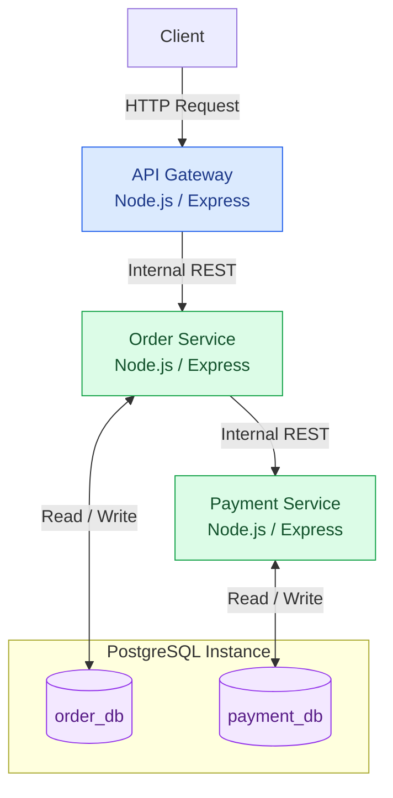

# Application Architecture

## High-Level Architecture

The following diagram illustrates the main application components and their communication paths.

## Architecture Decisions

| Decision | Choice |
|---|---|
| Backend runtime | Node.js |
| Web framework | Express |
| Application language | JavaScript |
| Database | PostgreSQL |
| Database deployment | One PostgreSQL instance |
| Data ownership | Separate database per service |
| Communication | Synchronous REST |
| Payment processing | Simulated |
| Initial environment | Ubuntu WSL and Docker Desktop |

## Service Boundaries

- The API Gateway handles incoming client requests.
- The Order Service owns order operations and `order_db`.
- The Payment Service owns payment operations and `payment_db`.
- Services access their own databases rather than directly accessing another service's database.

## Future Extensions

The application will progressively be extended with:

- Containerization using Docker.
- Application metrics and visualization.
- Centralized logging.
- Distributed tracing.
- Alerting and incident simulation.
- Kubernetes deployment.
