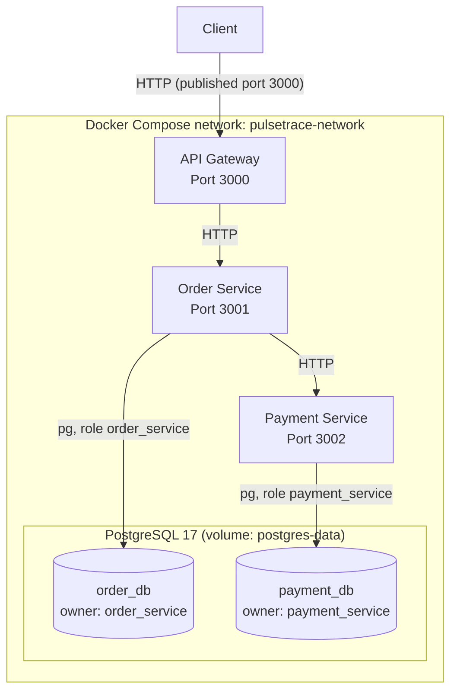
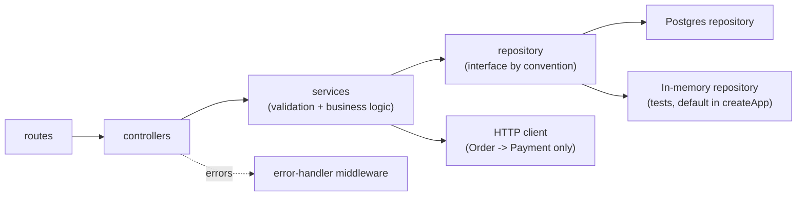

# PulseTrace Architecture

## 1. Overview

PulseTrace is a microservices-based application built with Node.js and Express, persisted in PostgreSQL and packaged with Docker Compose.

The application consists of three independent services and one PostgreSQL instance:

- **API Gateway:** Entry point for client requests.
- **Order Service:** Handles order creation and retrieval. Owns `order_db`.
- **Payment Service:** Handles payment processing and retrieval. Owns `payment_db`.
- **PostgreSQL:** One server hosting two isolated databases.

Services communicate through synchronous HTTP requests.

The project is being developed incrementally, with a primary focus on implementing monitoring and observability across a distributed application.

## 2. High-Level Architecture

Only the API Gateway is published to the host. The Order Service, Payment Service, and PostgreSQL are reachable only inside the Compose network. See [Deployment](./deployment.md).

## 3. Core Services

### API Gateway

**Responsibility:** Acts as the single entry point for client requests.

- Exposes the public API endpoints.
- Forwards order requests to the Order Service.
- Returns the upstream service response to the client.
- Handles connection failures and request timeouts.
- Exposes a basic health endpoint.
- Stateless: no database.

**Default Port:** `3000`

### Order Service

**Responsibility:** Manages order creation and retrieval.

- Validates incoming order requests.
- Creates orders with an initial `PENDING` status.
- Persists orders in `order_db` through `PostgresOrderRepository`.
- Applies SQL migrations at startup.
- Sends payment requests to the Payment Service.
- Updates order status based on payment results.
- Handles payment request failures without failing the initial order creation request.
- Exposes a basic health endpoint.

**Default Port:** `3001`

### Payment Service

**Responsibility:** Processes simulated payment requests and stores payment results.

- Validates payment requests.
- Creates payment records in `payment_db` through `PostgresPaymentRepository`.
- Applies SQL migrations at startup.
- Supports simulated successful and failed payment outcomes.
- Exposes payment retrieval endpoints.
- Exposes a basic health endpoint.

**Default Port:** `3002`

### Internal Layering (Order and Payment Services)

`createApp()` accepts injected dependencies. `server.js` injects the PostgreSQL repository, tests inject in-memory repositories and mock clients.

## 4. Service Communication

PulseTrace uses synchronous HTTP communication.

The request flow is:

1. The client sends an order request to the API Gateway.
2. The API Gateway forwards the request to the Order Service.
3. The Order Service creates and stores a `PENDING` order.
4. The Order Service sends a payment request to the Payment Service.
5. The Payment Service processes and stores the payment result.
6. The Order Service updates the order status based on the result.
7. The response travels back through the API Gateway to the client.

### Communication Characteristics

| Characteristic | Current Implementation |
|---|---|
| Communication style | Synchronous |
| Protocol | HTTP |
| Data format | JSON |
| Service discovery | Configured service URLs (Compose DNS names in containers) |
| Request timeout | 3000 ms |
| Retry mechanism | Not implemented |
| Message broker | Not implemented |

Service URLs are configured through environment variables:

| Variable | Local default | Compose value |
|---|---|---|
| `ORDER_SERVICE_URL` | `http://localhost:3001` | `http://order-service:3001` |
| `PAYMENT_SERVICE_URL` | `http://localhost:3002` | `http://payment-service:3002` |

## 5. Data Management

Each service owns its own database. No service reads another service's database, and there are no cross-database foreign keys.

| Service | Database | DB role | Repository |
|---|---|---|---|
| Order Service | `order_db` | `order_service` | `PostgresOrderRepository` |
| Payment Service | `payment_db` | `payment_service` | `PostgresPaymentRepository` |

Both databases live on one PostgreSQL server, which keeps local operation simple while preserving logical data ownership. A separate administrative role (`pulsetrace_admin`) exists only to bootstrap roles and databases.

In-memory repositories (`InMemoryOrderRepository`, `InMemoryPaymentRepository`) are retained for unit and API tests.

Schema creation, migration tracking, and table details are in [Data Model](./data-model.md).

## 6. Error Handling and Failure Boundaries

Each service handles errors within its own responsibility.

| Failure Scenario | Current Behavior |
|---|---|
| Invalid client request | Validation error returned |
| Unknown resource | Resource-specific `404` error |
| Unknown route | `404 ROUTE_NOT_FOUND` |
| Gateway cannot connect to Order Service | `503 Service Unavailable` |
| Gateway request to Order Service times out | `504 Gateway Timeout` |
| Order Service cannot complete Payment request | Order remains `PENDING` |
| Payment processing fails | Order becomes `PAYMENT_FAILED` |
| Database unreachable at startup | Service logs the error and exits with a non-zero code |
| Unexpected database error during a request | `500` response (see [Error Handling](../api/error-handling.md)) |

The implementation does not include automatic retries or distributed transaction management.

## 7. Observability Architecture

Observability is the main engineering focus of PulseTrace.

The application is being developed to progressively introduce observability capabilities across its microservices.

The planned observability stack includes:

| Component | Planned Responsibility |
|---|---|
| Prometheus | Metrics collection and monitoring |
| Grafana | Metrics visualization and dashboards |
| Alertmanager | Alert routing and management |
| Loki | Centralized log storage |
| Fluent Bit | Log collection and forwarding |
| OpenTelemetry | Instrumentation and telemetry generation |
| Jaeger | Distributed tracing visualization |

These components are planned integrations and should not be considered part of the current running architecture until implemented and verified.

## 8. Infrastructure and Delivery Roadmap

| Area | Technology | Status | Purpose |
|---|---|---|---|
| Containerization | Docker | Implemented | Package individual services |
| Local orchestration | Docker Compose | Implemented | Run the application and PostgreSQL |
| Persistent storage | PostgreSQL | Implemented | Store service data |
| Metrics | Prometheus | Planned | Collect application metrics |
| Visualization | Grafana | Planned | Build monitoring dashboards |
| Logging | Loki + Fluent Bit | Planned | Centralize application logs |
| Tracing | OpenTelemetry + Jaeger | Planned | Trace requests across services |
| Alerting | Alertmanager | Planned | Manage monitoring alerts |
| Orchestration | Kubernetes | Planned | Deploy and manage containers |
| CI/CD | GitHub Actions | Planned | Automate testing and delivery |

## 9. Architecture Principles

- **Service Separation:** Each microservice owns a specific responsibility.
- **Independent Data Ownership:** Each service has its own database, role, and migrations.
- **Explicit Communication:** Services communicate through defined HTTP interfaces.
- **Failure Isolation:** A failure in one service should be handled at the appropriate service boundary.
- **Least Exposure:** Only the gateway is reachable from the host.
- **Incremental Development:** New infrastructure and observability capabilities are introduced in verified stages.
- **Observability First:** Monitoring, logging, tracing, and alerting are central to the project's evolution.

## 10. Related Documentation

- [System Overview](./system-overview.md)
- [Deployment](./deployment.md)
- [Data Model](./data-model.md)
- [Request Flow](./request-flow.md)
- [API Contracts](../api/api-contracts.md)
- [Error Handling](../api/error-handling.md)
