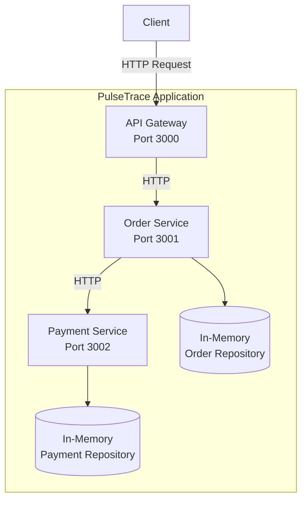

# PulseTrace Architecture

## 1. Overview

PulseTrace is a microservices-based application built with Node.js and Express.

The application currently consists of three independent services:

- **API Gateway:** Entry point for client requests.
- **Order Service:** Handles order creation and retrieval.
- **Payment Service:** Handles payment processing and retrieval.

Services communicate through synchronous HTTP requests.

The project is being developed incrementally, with a primary focus on implementing monitoring and observability across a distributed application.

## 2. High-Level Architecture

The following diagram represents the current application architecture.

## 3. Core Services

### API Gateway

**Responsibility:** Acts as the single entry point for client requests.

Current responsibilities:

- Exposes the public API endpoints.
- Forwards order requests to the Order Service.
- Returns the upstream service response to the client.
- Handles connection failures and request timeouts.
- Exposes a basic health endpoint.

**Default Port:** `3000`

### Order Service

**Responsibility:** Manages order creation and retrieval.

Current responsibilities:

- Validates incoming order requests.
- Creates orders with an initial `PENDING` status.
- Stores orders using an in-memory repository.
- Sends payment requests to the Payment Service.
- Updates order status based on payment results.
- Handles payment request failures without failing the initial order creation request.
- Exposes a basic health endpoint.

**Default Port:** `3001`

### Payment Service

**Responsibility:** Processes simulated payment requests and stores payment results.

Current responsibilities:

- Validates payment requests.
- Creates payment records.
- Supports simulated successful and failed payment outcomes.
- Stores payment records using an in-memory repository.
- Exposes payment retrieval endpoints.
- Exposes a basic health endpoint.

**Default Port:** `3002`

## 4. Service Communication

PulseTrace currently uses synchronous HTTP communication.

The request flow is:

1. The client sends an order request to the API Gateway.
2. The API Gateway forwards the request to the Order Service.
3. The Order Service creates and stores a `PENDING` order.
4. The Order Service sends a payment request to the Payment Service.
5. The Payment Service processes and stores the payment result.
6. The Order Service updates the order status based on the result.
7. The response travels back through the API Gateway to the client.

### Communication Characteristics

| Characteristic | Current Implementation |
|---|---|
| Communication style | Synchronous |
| Protocol | HTTP |
| Data format | JSON |
| Service discovery | Configured service URLs |
| Request timeout | 3000 ms |
| Retry mechanism | Not implemented |
| Message broker | Not implemented |

Service URLs can be configured through environment variables:

- `ORDER_SERVICE_URL`
- `PAYMENT_SERVICE_URL`

The clients use localhost URLs by default.

## 5. Data Management

Each service owns its own in-memory repository.

| Service | Repository | Storage |
|---|---|---|
| Order Service | `InMemoryOrderRepository` | In-memory Map |
| Payment Service | `InMemoryPaymentRepository` | In-memory Map |

This approach keeps the initial implementation simple and allows the project to focus on service communication and observability.

**Current limitation:** Data is not persistent. Restarting a service removes its stored records.

### Planned Data Architecture

PostgreSQL is planned for persistent storage.

Each service will own its database, preserving service-level data ownership and avoiding direct database sharing between services.

## 6. Error Handling and Failure Boundaries

Each service handles errors within its own responsibility.

| Failure Scenario | Current Behavior |
|---|---|
| Invalid client request | Validation error returned |
| Unknown resource | Resource-specific `404` error |
| Unknown route | `404 ROUTE_NOT_FOUND` |
| Gateway cannot connect to Order Service | `503 Service Unavailable` |
| Gateway request to Order Service times out | `504 Gateway Timeout` |
| Order Service cannot complete Payment request | Order remains `PENDING` |
| Payment processing fails | Order becomes `PAYMENT_FAILED` |

The current implementation does not include automatic retries or distributed transaction management.

For additional details, see [Error Handling](../api/error-handling.md).

## 7. Observability Architecture

Observability is the main engineering focus of PulseTrace.

The application is being developed to progressively introduce observability capabilities across its microservices.

The planned observability stack includes:

| Component | Planned Responsibility |
|---|---|
| Prometheus | Metrics collection and monitoring |
| Grafana | Metrics visualization and dashboards |
| Alertmanager | Alert routing and management |
| Loki | Centralized log storage |
| Fluent Bit | Log collection and forwarding |
| OpenTelemetry | Instrumentation and telemetry generation |
| Jaeger | Distributed tracing visualization |

These components are planned integrations and should not be considered part of the current running architecture until implemented and verified.

## 8. Infrastructure and Delivery Roadmap

The project is designed to evolve beyond the initial local application.

| Area | Planned Technology | Purpose |
|---|---|---|
| Containerization | Docker | Package individual services |
| Local orchestration | Docker Compose | Run the application and supporting infrastructure |
| Persistent storage | PostgreSQL | Store service data |
| Metrics | Prometheus | Collect application metrics |
| Visualization | Grafana | Build monitoring dashboards |
| Logging | Loki + Fluent Bit | Centralize application logs |
| Tracing | OpenTelemetry + Jaeger | Trace requests across services |
| Alerting | Alertmanager | Manage monitoring alerts |
| Orchestration | Kubernetes | Deploy and manage containers |
| CI/CD | GitHub Actions | Automate testing and delivery |

## 9. Architecture Principles

PulseTrace follows these principles:

- **Service Separation:** Each microservice owns a specific responsibility.
- **Independent Data Ownership:** Services manage their own data.
- **Explicit Communication:** Services communicate through defined HTTP interfaces.
- **Failure Isolation:** A failure in one service should be handled at the appropriate service boundary.
- **Incremental Development:** New infrastructure and observability capabilities are introduced in verified stages.
- **Observability First:** Monitoring, logging, tracing, and alerting are central to the project's evolution.

## 10. Related Documentation

- [System Overview](./system-overview.md)
- [Request Flow](./request-flow.md)
- [API Contracts](../api/api-contracts.md)
- [Error Handling](../api/error-handling.md)