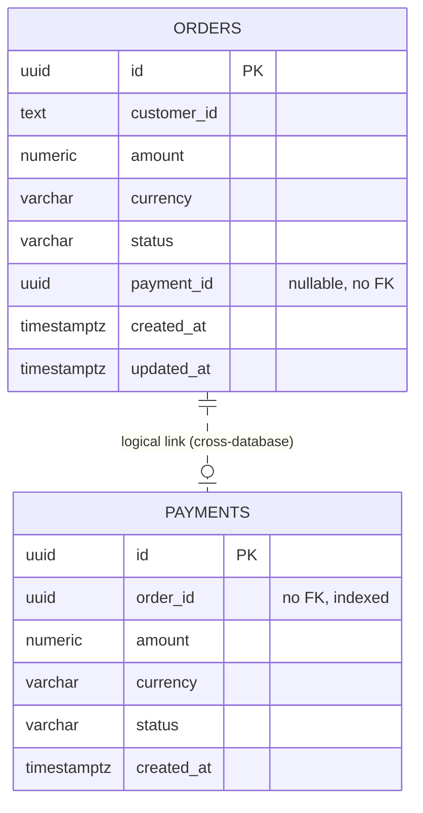
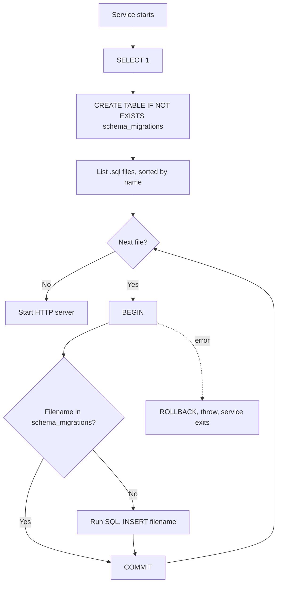

# Data Model

## 1. Overview

Each service that stores data owns a PostgreSQL database. Both databases are hosted by one PostgreSQL 17 server.

| Database | Owner service | DB role | Table |
|---|---|---|---|
| `order_db` | Order Service | `order_service` | `orders` |
| `payment_db` | Payment Service | `payment_service` | `payments` |

Each database also contains a `schema_migrations` table maintained by the service's migration runner. The API Gateway has no database.

The administrative role `pulsetrace_admin` is used only by the init script and by test/inspection commands.

## 2. Entity Relationship

The two tables are related logically through `payments.order_id` and `orders.payment_id`, but they are in separate databases, so no foreign key exists.

## 3. Tables

### `orders` (`order_db`)

Migration: `database/migrations/order/001_create_orders.sql`

| Column | Type | Constraints |
|---|---|---|
| `id` | `UUID` | Primary key |
| `customer_id` | `TEXT` | Not null |
| `amount` | `NUMERIC` | Not null, `> 0` |
| `currency` | `VARCHAR(3)` | Not null, matches `^[A-Z]{3}$` |
| `status` | `VARCHAR(30)` | Not null, one of `PENDING`, `PAID`, `PAYMENT_FAILED` |
| `payment_id` | `UUID` | Nullable |
| `created_at` | `TIMESTAMPTZ` | Not null, default `NOW()` |
| `updated_at` | `TIMESTAMPTZ` | Not null, default `NOW()` |

Index: `idx_orders_customer_id` on `customer_id`.

### `payments` (`payment_db`)

Migration: `database/migrations/payment/001_create_payments.sql`

| Column | Type | Constraints |
|---|---|---|
| `id` | `UUID` | Primary key |
| `order_id` | `UUID` | Not null |
| `amount` | `NUMERIC` | Not null, `> 0` |
| `currency` | `VARCHAR(3)` | Not null, matches `^[A-Z]{3}$` |
| `status` | `VARCHAR(30)` | Not null, one of `SUCCEEDED`, `FAILED` |
| `created_at` | `TIMESTAMPTZ` | Not null, default `NOW()` |

Index: `idx_payments_order_id` on `order_id`. The index is not unique, so several payments may reference the same order.

### Validation Layers

Rules are enforced twice: in the service's validation code and again as database constraints.

| Rule | Application | Database |
|---|---|---|
| Amount is positive | Yes | `CHECK (amount > 0)` |
| Currency is three uppercase letters | Yes | `CHECK (currency ~ '^[A-Z]{3}$')` |
| Status is one of the allowed values | Set by code | `CHECK (status IN (...))` |
| IDs are UUIDs | Generated with `randomUUID()`, lookup IDs and the payment `orderId` checked for UUID format | `UUID` type |

## 4. Migrations

Each persistent service applies migrations itself at startup through `src/database/run-migrations.js`. Migration files are plain SQL in `database/migrations/<service>/`.

`schema_migrations`:

| Column | Type | Notes |
|---|---|---|
| `filename` | `TEXT` | Primary key |
| `applied_at` | `TIMESTAMPTZ` | Default `NOW()` |

Rules for adding a migration:

- Add a new file with a higher, zero-padded prefix, for example `002_add_column.sql`. Files are applied in sorted filename order.
- Never edit an applied migration. The runner tracks filenames only, not checksums, so an edit is silently ignored on databases that already applied it.
- Each file runs inside one transaction together with its tracking row.
- Migrations are included in the Docker image from `database/migrations/<service>`. Rebuild the image after adding one.
- Statements that cannot run inside a transaction are not supported by this runner.

## 5. Repository Layer

Services depend on a repository contract, not on PostgreSQL directly.

| Service | Contract methods | PostgreSQL implementation | In-memory implementation |
|---|---|---|---|
| Order | `create`, `findById`, `update` | `PostgresOrderRepository` | `InMemoryOrderRepository` |
| Payment | `create`, `findById` | `PostgresPaymentRepository` | `InMemoryPaymentRepository` |

- `server.js` creates one `pg` `Pool` and injects the PostgreSQL repository into `createApp`.
- Tests call `createApp()` without a repository and get the in-memory one.
- All SQL uses parameterized queries (`$1`, `$2`, ...).
- `PostgresOrderRepository.update` accepts only `status`, `paymentId`, and `updatedAt`, mapped through a fixed allow-list of column names. Any other key throws.
- Rows are mapped to API objects: snake_case to camelCase, `NUMERIC` (returned as string by `pg`) to `Number`, timestamps to ISO strings.

### Connection Configuration

The pool takes its settings from standard `PG*` environment variables (`PGHOST`, `PGPORT`, `PGDATABASE`, `PGUSER`, `PGPASSWORD`). `server.js` is the only place that creates the pool, and it sets `connectionTimeoutMillis: 5000`. Pool size (`max: 10`) and idle timeout (30 seconds) use the `pg` defaults.

## 6. Data Ownership and Access

| Rule | Enforcement |
|---|---|
| A service reads and writes only its own database | Different database names and roles; credentials are provided per service in Compose |
| `order_service` cannot use `payment_db` | Separate role that owns only `order_db` |
| No cross-database queries or foreign keys | Separate databases |
| Cross-service data flows through HTTP | Order Service calls `POST /payments` |

## 7. Persistence Behavior

- Data survives service restarts and container recreation while the `postgres-data` volume exists.
- `docker compose down` keeps the volume. `docker compose down -v` deletes it, along with all orders and payments.
- When the volume is deleted, the init script and migrations recreate roles, databases, and tables on the next start.

## 8. Current Limitations

- `NUMERIC` has no declared precision or scale, and the API reads amounts back as JavaScript numbers.
- No foreign key or uniqueness guarantee between orders and payments.
- No `payment_id` consistency check: an order can stay `PENDING` while a payment for it exists (see [Error Handling](../api/error-handling.md#8-order-state-consistency)).
- Migrations are forward-only; there is no down/rollback mechanism.
- Migration runner has no locking, so running several replicas of one service at once is not safeguarded against concurrent first-time migrations.
- No backup or restore procedure.
