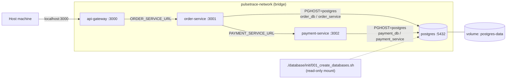
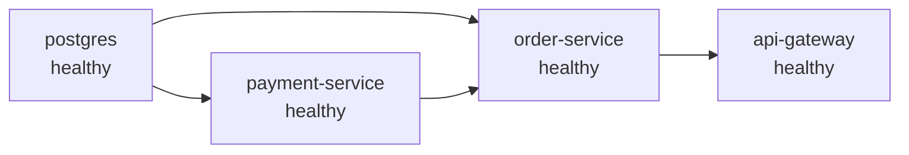
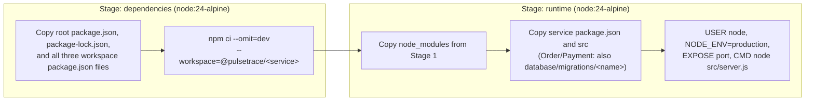

# Deployment (Docker and Docker Compose)

## 1. Overview

PulseTrace runs as four containers defined in `docker-compose.yaml` (project name `pulsetrace`):

| Container | Image | Port | Published | Health check |
|---|---|---|---|---|
| `postgres` | `postgres:17-alpine` | 5432 | No | `pg_isready` plus both databases exist |
| `payment-service` | `pulsetrace-payment-service:0.1.0` | 3002 | No | `GET /health` |
| `order-service` | `pulsetrace-order-service:0.1.0` | 3001 | No | `GET /health` |
| `api-gateway` | `pulsetrace-api-gateway:0.1.0` | 3000 | `3000:3000` | `GET /health` |

All containers share one user-defined bridge network, `pulsetrace-network`. PostgreSQL data lives in the named volume `postgres-data`.

## 2. Topology

## 3. Startup Order

`depends_on` with `condition: service_healthy` gates each container on the health of its dependencies.

Start order: `postgres` → `payment-service` → `order-service` → `api-gateway`.

The PostgreSQL health check passes only when the server accepts connections and both `order_db` and `payment_db` exist, so dependents never start against a half-initialized server.

## 4. Docker Images

The three service Dockerfiles share one pattern. The build context is the repository root, because the services are npm workspaces that share one `package-lock.json`.

| Property | Value |
|---|---|
| Base image | `node:24-alpine` |
| Build style | Multi-stage; dev dependencies and tests are not in the runtime image |
| Runtime user | `node` (non-root) |
| Default `NODE_ENV` | `production` (overridden by Compose, see below) |
| Migrations | Order and Payment images include only their own `database/migrations/<name>` directory |
| Gateway | No database, no migrations |

`.dockerignore` excludes `node_modules`, `.git`, `.env*`, `tests`, `docs`, `README.md`, build output, and logs. Secrets are never baked into images.

## 5. Compose Conventions

Shared settings use YAML anchors:

| Anchor | Content |
|---|---|
| `x-common-environment` | `NODE_ENV` (required, Compose fails if unset) |
| `x-common-service` | `init: true`, `restart: unless-stopped`, `stop_grace_period: 10s`, the shared network, and default health check timings |

Health check timings for the services: interval 10 s, timeout 3 s, retries 5, start period 5 s. PostgreSQL uses interval 5 s, timeout 5 s, retries 10, start period 20 s.

Service health checks run `node -e "fetch('http://127.0.0.1:<port>/health')..."` inside the container, so no extra tools are needed in the Alpine image.

`init: true` runs a minimal init process as PID 1, which forwards signals and reaps zombies. Together with the signal handlers in each `server.js` and a 10 s grace period, `docker compose stop` shuts services down cleanly.

## 6. Configuration

Compose reads variables from `.env` (copied from `.env.example`). Variables marked required use `${VAR:?message}`, so Compose refuses to start if they are missing.

| Variable | Used by | Purpose |
|---|---|---|
| `NODE_ENV` | All three services | `development` allows payment simulation, `production` rejects it |
| `POSTGRES_PASSWORD` | `postgres` | Password of the admin role `pulsetrace_admin` |
| `ORDER_DB_PASSWORD` | `postgres`, `order-service` | Password of role `order_service` |
| `PAYMENT_DB_PASSWORD` | `postgres`, `payment-service` | Password of role `payment_service` |

Variables set in the shell take precedence over `.env`. The Docker Compose test script depends on this (`export NODE_ENV=production`).

Per-service environment set in Compose:

| Service | Variables |
|---|---|
| `api-gateway` | `PORT=3000`, `ORDER_SERVICE_URL=http://order-service:3001` |
| `order-service` | `PORT=3001`, `PAYMENT_SERVICE_URL=http://payment-service:3002`, `PGHOST=postgres`, `PGPORT=5432`, `PGDATABASE=order_db`, `PGUSER=order_service`, `PGPASSWORD` |
| `payment-service` | `PORT=3002`, `PGHOST=postgres`, `PGPORT=5432`, `PGDATABASE=payment_db`, `PGUSER=payment_service`, `PGPASSWORD` |

`pg` reads the standard `PG*` variables, so the code contains no connection strings.

### Logging

The three application services write structured JSON logs to standard output, which Docker stores and `docker compose logs` reads. `LOG_LEVEL` (default `info`) sets the minimum level. Compose does not set it, so containers use the default. See [Observability](./observability.md).

## 7. Database Bootstrap

`database/init/001_create_databases.sh` is mounted read-only into `/docker-entrypoint-initdb.d/`. The PostgreSQL image runs it once, when the data directory is empty.

It is idempotent and creates:

1. Role `order_service` and role `payment_service` (login, passwords from the environment).
2. Database `order_db` owned by `order_service`.
3. Database `payment_db` owned by `payment_service`.

Passwords are passed to `psql` as variables and quoted with `format('%L')`, not interpolated into SQL by the shell.

Consequences of the "runs once" behavior:

- Changing `ORDER_DB_PASSWORD` or `PAYMENT_DB_PASSWORD` in `.env` after the first start does not change the role passwords stored in the volume. The services then fail to authenticate. Reset the volume (`docker compose down -v`, which deletes all data) or run `ALTER ROLE` manually.
- Table creation is not part of bootstrap. Each service applies its own migrations on startup (see [Data Model](./data-model.md)).

## 8. Service Lifecycle

| Phase | Behavior |
|---|---|
| Start | Order and Payment: `SELECT 1`, apply migrations, then `listen`. Gateway: `listen` immediately. |
| Start failure | Order and Payment log the error, close the pool, exit with code `1`. Compose restarts the container. |
| Stop (`SIGTERM`/`SIGINT`) | Stop accepting connections, wait for the HTTP server to close, then end the database pool. Gateway closes the server and exits. |
| Forced stop | Compose sends `SIGKILL` after `stop_grace_period` (10 s). |

## 9. Current Limitations

- Single PostgreSQL instance with no replication or backup strategy.
- Default PostgreSQL port is not published. Inspect data with `docker compose exec postgres psql ...` (see [Running Locally](../guides/running-locally.md)).
- Image tags are fixed at `0.1.0`; there is no registry push or versioning pipeline.
- No resource limits (CPU or memory) are configured.
- Health checks cover process liveness, not dependency health.
- Logs are kept only in Docker's container logs. No collection or rotation is configured.
- Order and Payment endpoints are not published to the host, so tests that call ports 3001 and 3002 directly work only when services run with npm.
- Kubernetes manifests and CI/CD are planned and not part of the current deployment.
