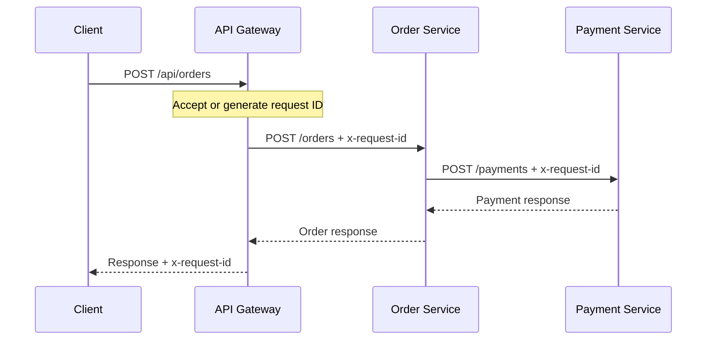
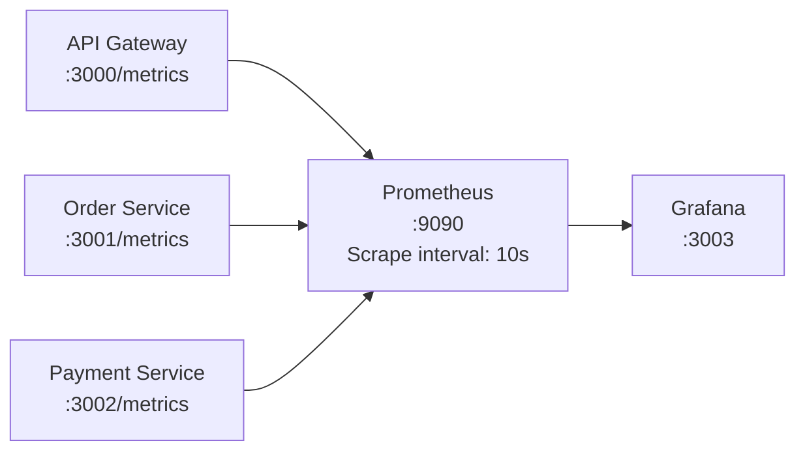

# Observability

## 1. Overview

PulseTrace builds observability incrementally. Each capability is implemented, tested, and documented before the next stage begins.

| Capability | Status | Notes |
|---|---|---|
| Structured JSON logging | Implemented | Pino, one logger per service |
| Request ID correlation | Implemented | `x-request-id` propagated across services |
| Logging correlation test | Implemented | `tests/logging-correlation-test.sh` |
| Prometheus metrics | Implemented | `/metrics` on all three services |
| Grafana dashboard | Implemented | Provisioned from JSON |
| Metrics integration test | Implemented | `tests/metrics-test.sh` |
| Distributed tracing | Planned | OpenTelemetry and Jaeger |
| Centralized logging | Planned | Fluent Bit and Loki |
| Alerting | Planned | Prometheus rules and Alertmanager |

This document describes the currently implemented logging, request correlation, metrics, Prometheus, and Grafana setup.

## 2. Logging Design

Each service writes structured JSON logs to standard output. Docker captures the output, and `docker compose logs` can retrieve it.

| Component | Responsibility |
|---|---|
| `config/logger.js` | Creates the Pino logger |
| `middleware/request-id.js` | Accepts or generates a request ID |
| `pino-http` | Logs HTTP requests and exposes `req.log` and `req.id` |
| Business logging | Records important business events |

The three services maintain their own logger and request ID helper files because they are built independently.

Controllers pass a small context object to the service layer:

```js
{
  requestId,
  logger
}
```

Code executed without a request context, such as unit tests, does not produce request-specific business logs.

## 3. Request ID Correlation

A request ID connects the log entries produced by the same client request across the services.



Rules:

- Clients may provide an `x-request-id` header.
- Accepted IDs contain letters, digits, and hyphens, with a maximum length of 64 characters.
- Invalid IDs are replaced with a generated UUID.
- The Gateway returns the request ID in its response header.
- The Gateway forwards the ID to Order Service.
- Order Service forwards the ID to Payment Service.

A request ID helps correlate logs. It is not a distributed trace ID.

## 4. Log Format

Every log line is a JSON object.

| Field | Description |
|---|---|
| `level` | Log severity |
| `time` | ISO 8601 timestamp |
| `service` | Service name |
| `msg` | Human-readable message |

HTTP request logs also contain:

| Field | Description |
|---|---|
| `req.id` | Request ID |
| `req.method` | HTTP method |
| `req.path` | Request path |
| `res.statusCode` | HTTP response status |
| `responseTime` | Request duration in milliseconds |

Example:

```json
{
  "level": "info",
  "time": "2026-11-08T16:33:09.727Z",
  "service": "api-gateway",
  "req": {
    "id": "abc-123",
    "method": "POST",
    "path": "/api/orders"
  },
  "res": {
    "statusCode": 201
  },
  "responseTime": 38,
  "msg": "request completed"
}
```

## 5. What Is and Is Not Logged

| Logged | Not logged |
|---|---|
| Request ID | Request and response bodies |
| HTTP method and path | Query strings |
| Response status and duration | Request headers |
| Order and payment IDs | Database credentials |
| Payment status | Customer request data |

`GET /health` and `GET /metrics` requests are excluded from request logs because they are frequent background requests.

## 6. Error Logging

Errors are logged using a compact error representation.

The serializer retains useful fields such as:

- `type`
- `message`
- `code`
- `cause`
- `stack`

The application logs the underlying error separately from the generic HTTP request failure log.

This keeps useful debugging information without logging every property attached to an error object.

## 7. Tracing One Request Through Logs

Send a request with a known ID:

```bash
curl -s -X POST http://localhost:3000/api/orders \
  -H "Content-Type: application/json" \
  -H "x-request-id: trace-demo-1" \
  -d '{"customerId":"customer-123","amount":1500,"currency":"EGP"}'
```

Find the request across all services:

```bash
docker compose logs --no-log-prefix \
  api-gateway order-service payment-service \
  | jq -R -c '
      fromjson?
      | select(.req.id == "trace-demo-1")
      | {time, service, msg}
    ' \
  | sort
```

This is log correlation using a shared request ID. Distributed tracing with spans and trace context is still planned.

## 8. Metrics Design

Logs help explain individual events. Metrics provide numerical measurements of system behavior over time.

PulseTrace exposes metrics from all three services.



| Component | Responsibility |
|---|---|
| `config/metrics.js` | Creates a registry and defines metrics |
| `middleware/metrics.js` | Records HTTP request counts and durations |
| `GET /metrics` | Exposes metrics in Prometheus text format |

Each `createApp()` call creates its own registry. This prevents duplicate metric registration between independent test application instances.

### 8.1 Application Metrics

| Metric | Type | Labels | Service |
|---|---|---|---|
| `http_requests_total` | Counter | `method`, `route`, `status_code` | All |
| `http_request_duration_seconds` | Histogram | `method`, `route`, `status_code` | All |
| `orders_created_total` | Counter | `status` | Order |
| `payments_processed_total` | Counter | `status` | Payment |
| `gateway_upstream_errors_total` | Counter | `code` | Gateway |

The services also expose default Node.js and process metrics from `prom-client`, including metrics with prefixes such as `process_` and `nodejs_`.

### 8.2 HTTP Request Counter

`http_requests_total` counts the number of HTTP requests handled by a service.

It is a Counter, which means its value increases over time and resets when the process restarts.

Example PromQL:

```promql
sum(rate(http_requests_total[1m])) by (service)
```

This calculates the per-second request rate for each service over the last minute.

### 8.3 HTTP Request Duration

`http_request_duration_seconds` is a Histogram.

It records request durations in seconds and groups observations into configured buckets.

Configured bucket boundaries:

- 0.005 seconds
- 0.01 seconds
- 0.025 seconds
- 0.05 seconds
- 0.1 seconds
- 0.25 seconds
- 0.5 seconds
- 1 second
- 2.5 seconds
- 5 seconds

A histogram exposes bucket counters, a sum, and a count.

Example p95 query:

```promql
histogram_quantile(
  0.95,
  sum(
    rate(http_request_duration_seconds_bucket[5m])
  ) by (le)
)
```

This estimates the 95th percentile request duration over the selected five-minute window.

### 8.4 Business Metrics

`orders_created_total` counts created orders grouped by their final status.

Example:

```promql
sum(orders_created_total) by (status)
```

`payments_processed_total` counts processed payments grouped by status.

Example:

```promql
sum(payments_processed_total) by (status)
```

`gateway_upstream_errors_total` counts errors encountered when the Gateway communicates with upstream services.

Example:

```promql
sum(gateway_upstream_errors_total) by (code)
```

### 8.5 Route Labels and Cardinality

The `route` label must contain a route pattern, not a real request path.

| Request path | Route label |
|---|---|
| `/api/orders/ea0811ff-...` | `/api/orders/:id` |
| `/orders` | `/orders` |
| `/payments/<id>` | `/payments/:id` |
| An unmatched path | `unmatched` |

Using real IDs in labels would create a new time series for every request. This is known as high cardinality and can increase Prometheus storage and query costs.

### 8.6 Excluded Requests

`GET /health` and `GET /metrics` are excluded from application request metrics and request logs.

These endpoints are used by health checks and Prometheus scrapes. Counting them as normal application traffic would distort the measurements.

## 9. Prometheus

Prometheus runs in the separate observability Compose file:

`docker-compose.observability.yaml`

| Property | Value |
|---|---|
| Image | `prom/prometheus:v3.5.0` |
| Host port | `9090` |
| Configuration | `observability/prometheus/prometheus.yml` |
| Scrape interval | 10 seconds |
| Retention | 7 days |
| Storage | `prometheus-data` volume |

Prometheus discovers the services through the Docker network:

- `api-gateway:3000`
- `order-service:3001`
- `payment-service:3002`

The targets can be inspected at:

`http://localhost:9090/targets`

Counters restart from zero when their application container restarts. Prometheus may still retain older time series during its retention period.

## 10. Grafana

Grafana runs alongside Prometheus in the observability Compose file.

| Property | Value |
|---|---|
| Image | `grafana/grafana:12.1.0` |
| Host port | `3003` |
| Username | `admin` |
| Password | `GRAFANA_ADMIN_PASSWORD` from `.env` |
| Data source | `observability/grafana/provisioning/datasources/datasources.yml` |
| Dashboard provider | `observability/grafana/provisioning/dashboards/dashboards.yml` |
| Dashboard JSON | `observability/grafana/dashboards/pulsetrace-overview.json` |

Grafana uses port `3003` on the host because port `3000` is already used by the API Gateway.

The dashboard is provisioned from a JSON file. Its provider configuration disables UI updates, so dashboard changes should be made in the JSON source file.

## 11. PulseTrace – System Overview Dashboard

The Grafana dashboard is titled:

**PulseTrace – System Overview**

It groups the main metrics into four areas:

| Section | Purpose |
|---|---|
| System Health | Service availability and upstream health |
| HTTP Performance | Request rate, error rate, and latency |
| Business Metrics | Order and payment outcomes |
| Node.js Runtime | Runtime and event-loop measurements |

Some panels depend on events that do not happen during normal traffic.

Examples:

- Upstream error metrics require a Gateway-to-service communication failure.
- PENDING orders require a payment processing scenario where the Order Service cannot complete the payment flow.
- Business counters only show the statuses that have actually occurred since the service started.

An empty panel does not always indicate a broken query. Check whether the corresponding event happened within the selected dashboard time range.

The dashboard can be opened at:

`http://localhost:3003`

Use the Grafana admin credentials configured in `.env`.

## 12. Useful PromQL Queries

### Request rate per service

```promql
sum(rate(http_requests_total[1m])) by (service)
```

### Gateway 5xx error rate

```promql
sum(
  rate(http_requests_total{
    service="api-gateway",
    status_code=~"5.."
  }[5m])
)
/
sum(
  rate(http_requests_total{
    service="api-gateway"
  }[5m])
)
```

### Gateway p95 latency

```promql
histogram_quantile(
  0.95,
  sum(
    rate(http_request_duration_seconds_bucket{
      service="api-gateway"
    }[5m])
  ) by (le)
)
```

### Orders grouped by status

```promql
sum(orders_created_total) by (status)
```

### Payments grouped by status

```promql
sum(payments_processed_total) by (status)
```

### Gateway upstream errors

```promql
sum(gateway_upstream_errors_total) by (code)
```

## 13. Testing

The observability implementation has two main verification levels.

### Unit tests

The service-level metrics tests verify:

- Metrics endpoint output.
- HTTP request metrics.
- Route pattern labels.
- Exclusion of health and metrics probes.
- Business counters.

### Integration test

`tests/metrics-test.sh` verifies the running observability stack.

It checks:

- Compose configuration and container health.
- Prometheus targets.
- Metrics endpoints.
- Business counter changes after real requests.
- Route label safety.
- Probe exclusion from metrics and logs.
- Grafana data source provisioning.
- Dashboard provisioning.
- Dashboard JSON validity.
- PromQL query validity.

The latest recorded run completed with:

| Result | Count |
|---|---:|
| Passed | 15 |
| Failed | 0 |
| Skipped | 0 |
| Total | 15 |

Report:

`tests/reports/metrics-test-2026-11-10_17-42-51.md`

See [Testing](../guides/testing.md#7-metrics-test) for execution details.

## 14. Roadmap

| Capability | Planned implementation | Builds on |
|---|---|---|
| Distributed tracing | OpenTelemetry and Jaeger | Request ID correlation |
| Centralized logging | Fluent Bit and Loki | Structured JSON logs |
| Alerting | Prometheus alert rules and Alertmanager | Application metrics |

These capabilities are not described as implemented until they are added and verified.

## 15. Known Limitations

- Logs are currently available through Docker container logs only.
- Logs are not centrally collected or searchable through Loki yet.
- A request ID is not a distributed trace ID.
- Metrics are scraped every 10 seconds, so very short spikes may be missed.
- Application counters reset when a service container restarts.
- Old Prometheus time series can remain visible for up to seven days.
- Some business and error metrics require specific events before they have data.
- Prometheus and Grafana data are stored in named volumes.
- `docker compose down -v` removes named volumes, including observability data.
- Alerting is not implemented yet.
