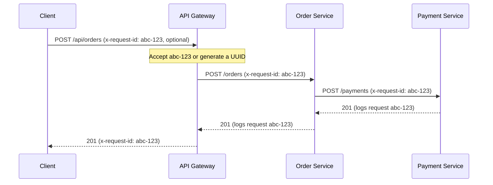
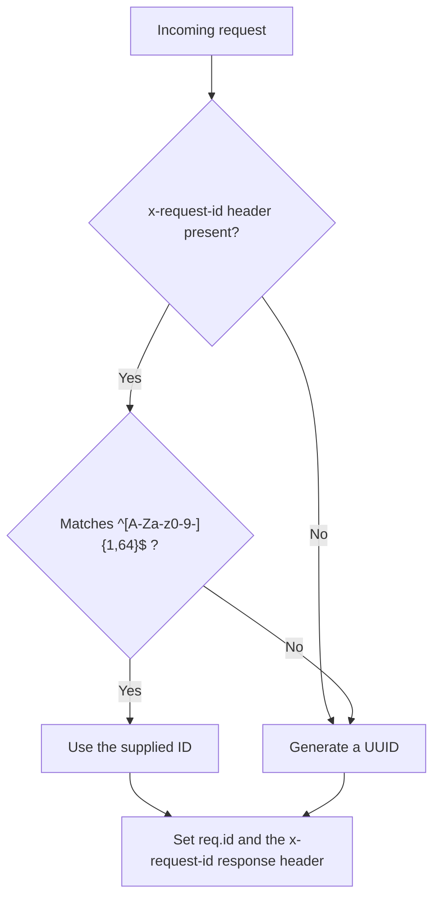

# Observability

## 1. Overview

PulseTrace builds observability in stages. Each stage is implemented, tested, and documented before the next one starts.

| Capability | Status | Notes |
|---|---|---|
| Structured JSON logging | Implemented | Pino, one logger per service |
| Request ID correlation across services | Implemented | `x-request-id` header |
| Logging correlation test | Implemented | `tests/logging-correlation-test.sh` |
| Metrics (Prometheus, Grafana) | Planned | |
| Distributed tracing (OpenTelemetry, Jaeger) | Planned | |
| Centralized logging (Fluent Bit, Loki) | Planned | |
| Alerting (Alertmanager) | Planned | |

This document describes what is implemented today: structured logs and request ID correlation. Planned capabilities are listed in [section 9](#9-roadmap).

## 2. Logging Design

Every service writes one JSON object per line to standard output. Docker captures the output, and `docker compose logs` reads it.

| Component | Where | Responsibility |
|---|---|---|
| `config/logger.js` | Each service | Creates the Pino logger: service name, ISO timestamp, text level, error serializer |
| `middleware/request-id.js` | Each service | Accepts or generates the request ID |
| `pino-http` | `app.js` of each service | Logs one line per request and exposes `req.log` and `req.id` |
| Business logs | Order and Payment services | Log the result of payment processing with the request logger |

The Gateway has its own copy of the two helper files. Services are built and deployed independently, so they do not share a package.

Controllers pass the request logger to the service layer through a small `context` argument (`{ requestId, logger }`). Code that is called without a context, such as unit tests, simply does not log.

## 3. Request ID Correlation

A request ID links the log lines that one client request produces in all three services.



How the ID is chosen:



Rules:

- A client may supply `x-request-id`. Only letters, digits, and hyphens are accepted, up to 64 characters. This stops arbitrary text from reaching the logs.
- Any other value is replaced with a generated UUID. The request is not rejected.
- Every Gateway response carries the ID in the `x-request-id` header.
- The Gateway forwards the ID to the Order Service, and the Order Service forwards it to the Payment Service.

## 4. Log Format

Every line has these fields:

| Field | Description |
|---|---|
| `level` | `info`, `warn`, `error` (text, not a number) |
| `time` | ISO 8601 timestamp in UTC |
| `service` | `api-gateway`, `order-service`, or `payment-service` |
| `msg` | Short message |

Request lines (written by `pino-http`) add:

| Field | Description |
|---|---|
| `req.id` | The request ID |
| `req.method` | HTTP method |
| `req.path` | Path without the query string |
| `res.statusCode` | Response status |
| `responseTime` | Duration in milliseconds |

Example request line:

```json
{"level":"info","time":"2026-11-08T16:33:09.727Z","service":"api-gateway","req":{"id":"abc-123","method":"POST","path":"/api/orders"},"res":{"statusCode":201},"responseTime":38,"msg":"request completed"}
```

Example business line from the Payment Service:

```json
{"level":"info","time":"2026-11-08T16:33:09.700Z","service":"payment-service","req":{"id":"abc-123","method":"POST","path":"/payments"},"paymentId":"13f67bcb-42ab-40d9-976b-5057e32ba4be","orderId":"ea0811ff-832e-4bcc-a797-aae75694a4df","status":"SUCCEEDED","msg":"Payment processed"}
```

### Messages

| Service | Message | Level | Extra fields |
|---|---|---|---|
| All | `request completed` | `info`, `warn` for `4xx` | request fields |
| All | `request failed` | `error` for `5xx` | request fields, `err` created by `pino-http` |
| All | `... listening` | `info` | `port` |
| All | `Shutting down ...` | `info` | `signal` |
| Gateway | `gateway error` | `error` for `5xx`, `warn` otherwise | `error` |
| Order, Payment | `Applied migration` | `info` | `migration` |
| Order, Payment | `Unhandled error` | `error` | `error` |
| Order | `Order payment processed` | `info` | `orderId`, `status`, `paymentId` |
| Order | `Payment processing failed, order left PENDING` | `error` | `orderId`, `error` |
| Payment | `Payment processed` | `info` | `paymentId`, `orderId`, `status` |

### Log Levels

The level of a request line follows the response status:

| Condition | Level |
|---|---|
| Status `5xx` or an error | `error` |
| Status `4xx` | `warn` |
| Anything else | `info` |

The minimum level comes from the `LOG_LEVEL` environment variable (default `info`). The `npm test` scripts set `LOG_LEVEL=silent`. Compose does not set `LOG_LEVEL`, so containers use `info`.

## 5. What Is and Is Not Logged

| Logged | Never logged |
|---|---|
| Request ID, method, path, status, duration | Request and response bodies |
| Order and payment IDs | Query strings |
| Payment status | Request headers (including `authorization` and `cookie`) |
| Error type, message, code, cause, and stack | Database credentials and `PG*` variables |

`customerId` and amounts are request data, so they are not written to logs. The correlation test checks this.

`GET /health` requests are not logged. Compose calls them every few seconds, and they would hide real traffic.

## 6. Error Logging

Errors are logged under the `error` key with a compact serializer:

```json
{"level":"error","time":"2026-11-08T16:24:10.120Z","service":"order-service","req":{"id":"abc-123","method":"POST","path":"/orders"},"error":{"type":"AbortError","message":"This operation was aborted","code":20,"stack":"AbortError: This operation was aborted"},"orderId":"52f5ae32-53c4-42b0-90f7-c449a70fa164","msg":"Payment processing failed, order left PENDING"}
```

The key is `error`, not `err`. `pino-http` forces its own serializer on `err` for request loggers, and the default one copies every property of errors such as `AbortError`, which adds dozens of useless fields. A custom serializer on `err` is ignored there.

The serializer keeps `type`, `message`, `code`, `cause`, and `stack`.

For a `5xx` response `pino-http` also writes its own `request failed` line, with a generic `err` and an internal stack. The `gateway error` or `Unhandled error` line next to it holds the real cause.

## 7. Tracing One Request

Send a request with a known ID, then collect the lines of all services:

```bash
curl -s -X POST http://localhost:3000/api/orders \
  -H "Content-Type: application/json" \
  -H "x-request-id: trace-demo-1" \
  -d '{"customerId":"customer-123","amount":1500,"currency":"EGP"}'

docker compose logs --no-log-prefix api-gateway order-service payment-service \
  | jq -R -c 'fromjson? | select(.req.id == "trace-demo-1") | {time, service, msg}' \
  | sort
```

Expected output, in order:

```text
{"time":"...","service":"payment-service","msg":"Payment processed"}
{"time":"...","service":"payment-service","msg":"request completed"}
{"time":"...","service":"order-service","msg":"Order payment processed"}
{"time":"...","service":"order-service","msg":"request completed"}
{"time":"...","service":"api-gateway","msg":"request completed"}
```

- `jq -R` reads each line as text, and `fromjson?` skips lines that are not JSON.
- `sort` orders the lines by `time`, which is the first field.

More queries:

| Goal | Command |
|---|---|
| Only errors of a service | `docker compose logs --no-log-prefix order-service \| jq -R -c 'fromjson? \| select(.level == "error")'` |
| Slow requests (over 500 ms) | `docker compose logs --no-log-prefix api-gateway \| jq -R -c 'fromjson? \| select(.responseTime > 500)'` |
| Failed payments | `docker compose logs --no-log-prefix payment-service \| jq -R -c 'fromjson? \| select(.status == "FAILED")'` |

## 8. Testing

`tests/logging-correlation-test.sh` checks the running stack with 13 checks: the supplied ID is returned, the same ID is logged by all three services, a generated ID is returned when none is supplied, unsafe IDs are replaced, failed payments are logged, health checks are not logged, and request data never reaches the logs. See [Testing](../guides/testing.md#6-logging-correlation-test).

## 9. Roadmap

| Phase | Adds | Builds on |
|---|---|---|
| Metrics | Prometheus metrics per service and a Grafana dashboard | Request fields already logged |
| Tracing | OpenTelemetry and Jaeger, with trace and span IDs in the logs | Request ID stays next to the trace ID |
| Centralized logging | Fluent Bit and Loki, queried from Grafana | JSON log format |
| Alerting | Prometheus alert rules and Alertmanager | Metrics |

## 10. Known Limitations

- Logs exist only in Docker's container logs. They are not collected, rotated, or searchable across restarts until Loki is added.
- The request ID is per HTTP request. It is not a trace ID, and it does not show timing inside a service.
- When a client disconnects before the response is sent, `pino-http` still logs the request with the default status `200`.
- `responseTime` uses the system clock. If the clock jumps (for example WSL2 after the host sleeps), a value can be negative.
- Stack traces are logged in full. This is acceptable for local development, not for production.
- A payment timeout is logged as an `AbortError` with the message `This operation was aborted`. See [Error Handling](../api/error-handling.md#52-payment-service-timeout).
