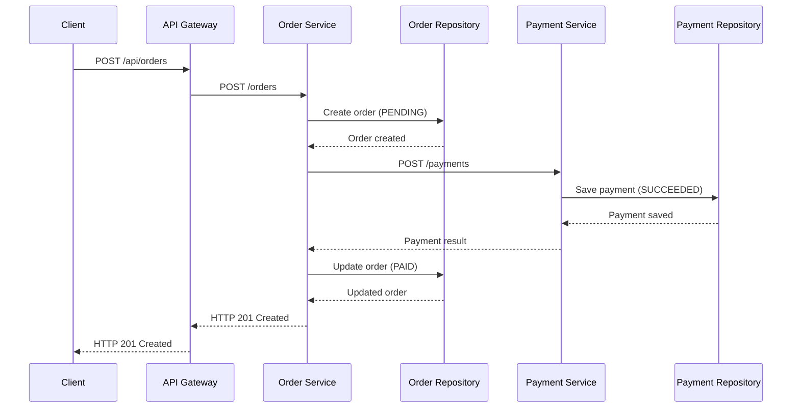
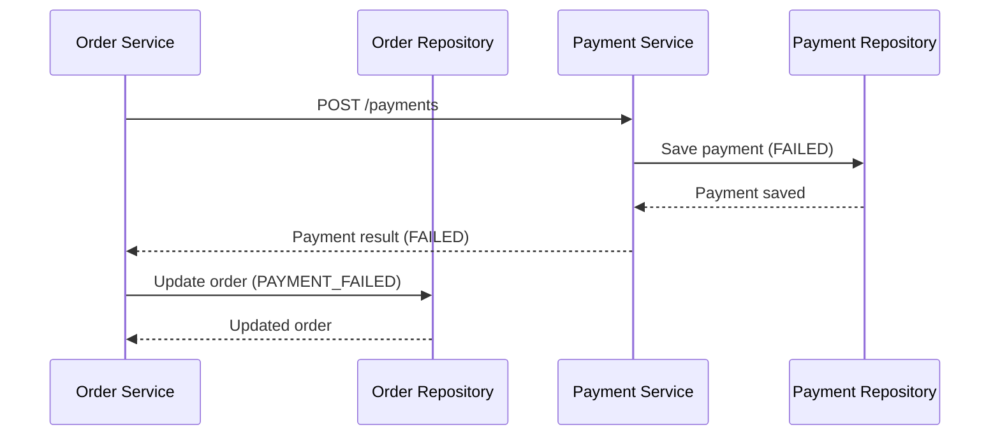
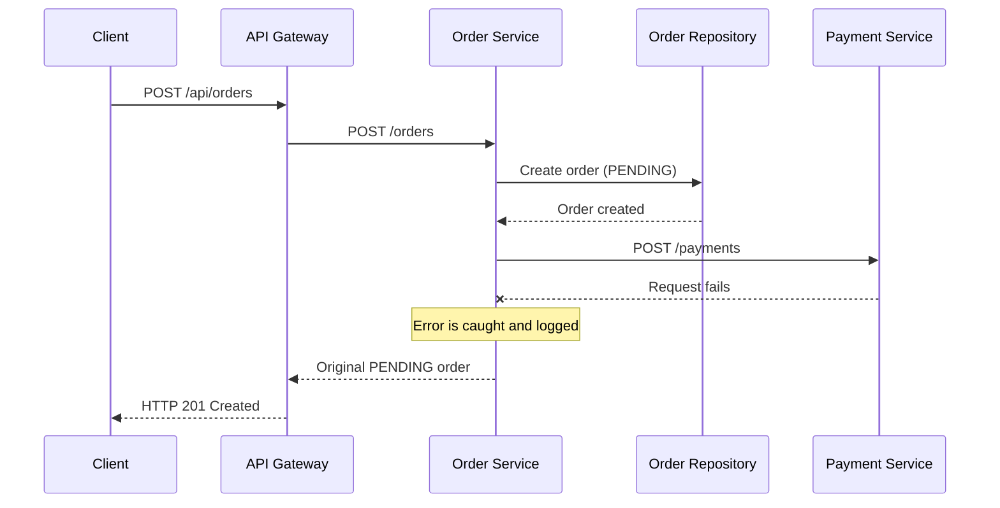

# Order Creation Request Flow

## Overview

PulseTrace uses synchronous HTTP communication to process order creation requests across three microservices.

The API Gateway receives client requests and forwards them to the Order Service. The Order Service creates an order with a `PENDING` status, then sends a payment request to the Payment Service.

The Payment Service processes the payment request and stores the result. Based on the response, the Order Service updates the order status.

The current implementation uses in-memory repositories. Data is not persistent and is lost when a service restarts.

## Successful Request Flow

The following sequence illustrates the complete order creation flow when payment succeeds.

## Payment Outcomes

The Payment Service can return either a successful or failed payment result.

### Successful Payment

When payment succeeds:

- The Payment Service creates a payment with `SUCCEEDED` status.
- The Order Service updates the order to `PAID`.
- The order response includes the generated `paymentId`.

### Failed Payment

When payment fails:

- The Payment Service creates a payment with `FAILED` status.
- The Order Service updates the order to `PAYMENT_FAILED`.
- The order response includes the generated `paymentId`.

## Payment Service Failure

If the Order Service cannot complete the payment request because of a connection error, timeout, or another request failure:

1. The Order Service has already saved the order with `PENDING` status.
2. The payment request fails.
3. The Order Service catches the error and logs it.
4. The original order is returned without a payment ID.
5. The API responds with `HTTP 201 Created`.

The order remains `PENDING`.

## Important Implementation Details

### Synchronous Communication

Service-to-service communication currently uses HTTP requests.

The Order Service waits for the Payment Service response before completing the order creation request.

### In-Memory Storage

Both services currently use in-memory repositories:

- `InMemoryOrderRepository` stores order records.
- `InMemoryPaymentRepository` stores payment records.

These repositories are temporary and do not provide persistent storage.

### Request Timeouts

The HTTP clients use a timeout of 3000 milliseconds.

The API Gateway maps Order Service connection failures and timeouts to:

- `503 Service Unavailable` for unavailable service connections.
- `504 Gateway Timeout` for timed-out requests.

The Order Service currently catches Payment Service request failures and returns the original `PENDING` order instead of propagating the error to the Gateway.

### Health Checks

Each service exposes a `/health` endpoint.

The current health checks verify that the service process is running. They do not verify the availability of dependent services.

## Current Limitations

The current request flow intentionally keeps business logic simple and focuses on service communication and observability.

Current limitations include:

- No persistent database storage.
- No automatic payment retries.
- No message broker or asynchronous processing.
- No distributed transaction management.
- No real payment provider integration.
- No dependency-aware health checks.

These limitations may be addressed in future project stages where relevant.