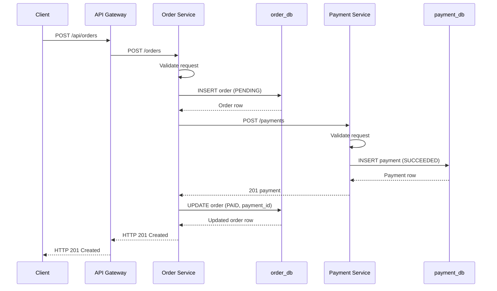
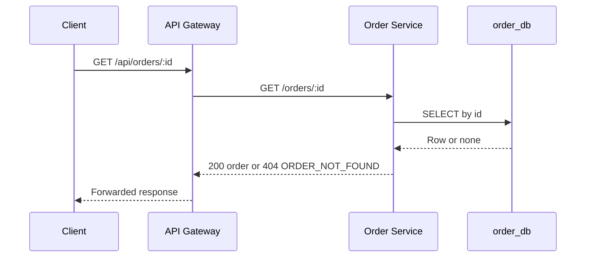
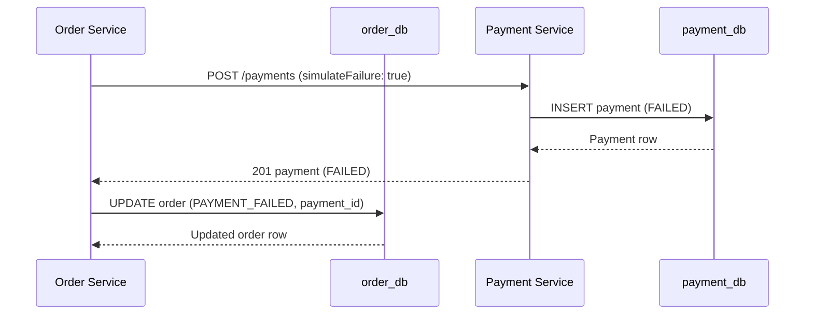
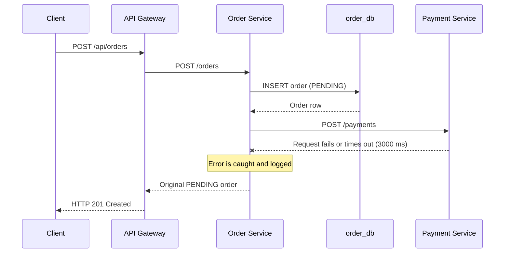
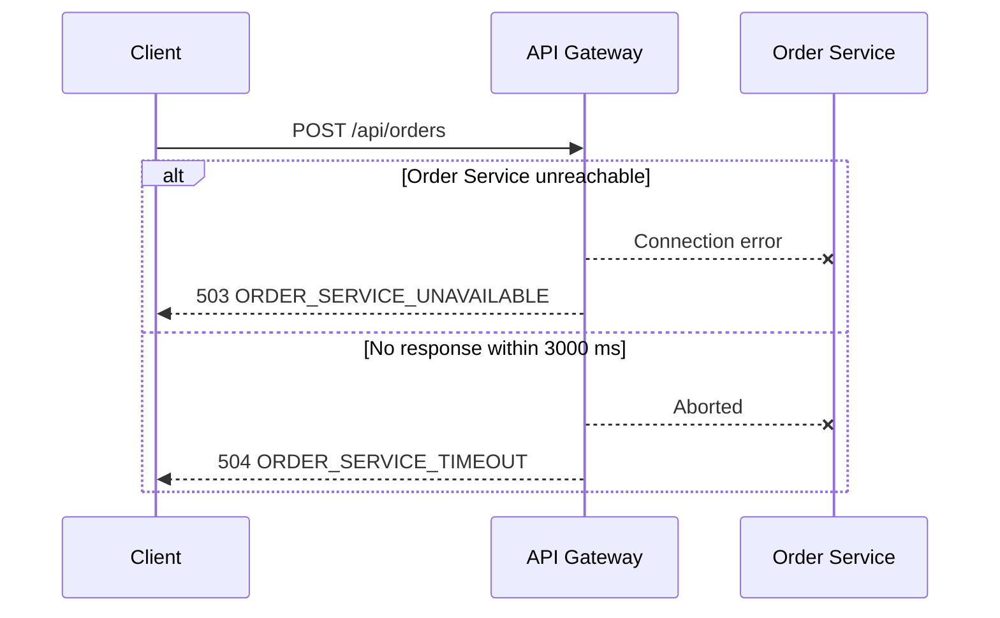
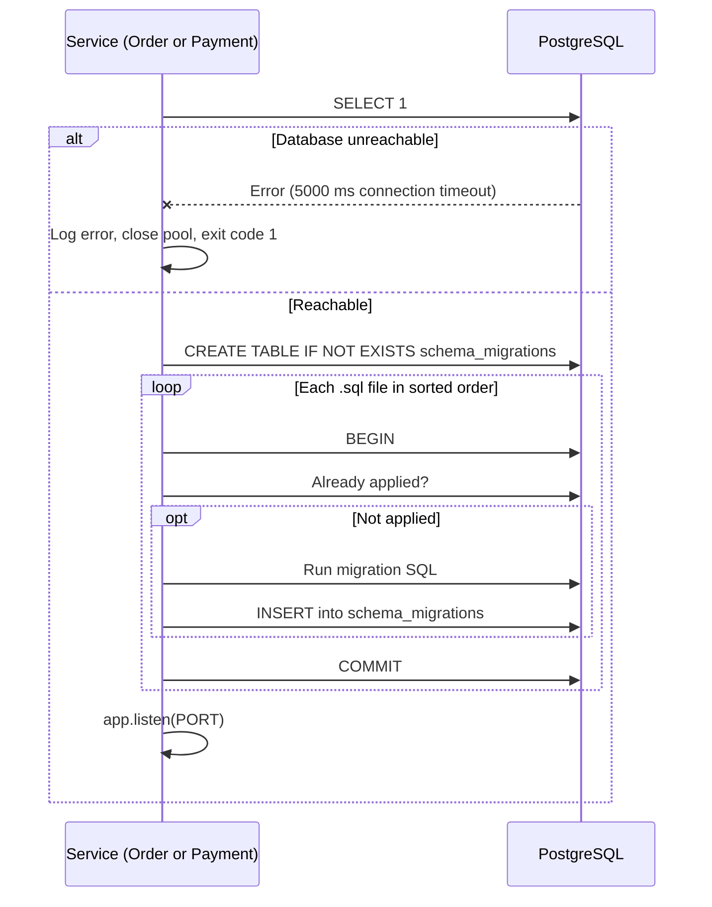

# Order Creation Request Flow

## Overview

PulseTrace uses synchronous HTTP communication to process order creation requests across three microservices.

The API Gateway receives client requests and forwards them to the Order Service. The Order Service creates an order with a `PENDING` status in `order_db`, then sends a payment request to the Payment Service.

The Payment Service processes the payment request and stores the result in `payment_db`. Based on the response, the Order Service updates the order status.

Data is persisted in PostgreSQL and survives service restarts.

## Successful Request Flow

## Retrieval Flow

Payments are retrieved the same way through `GET /payments/:id` on the Payment Service. That endpoint is internal and is not exposed by the Gateway or published to the host.

## Payment Outcomes

### Successful Payment

- The Payment Service creates a payment with `SUCCEEDED` status.
- The Order Service updates the order to `PAID`.
- The order response includes the generated `paymentId`.

### Failed Payment

When the request contains `simulateFailure: true` (non-production only):

- The Payment Service creates a payment with `FAILED` status.
- The Order Service updates the order to `PAYMENT_FAILED`.
- The order response includes the generated `paymentId`.

## Payment Service Failure

If the Order Service cannot complete the payment request because of a connection error, timeout, a non-2xx response, or a failure while updating the order afterwards:

1. The Order Service has already saved the order with `PENDING` status.
2. The payment step fails.
3. The Order Service catches the error and logs it.
4. The original order is returned without a payment ID.
5. The API responds with `HTTP 201 Created`.

The order remains `PENDING`.

A timeout does not prove the payment was not processed. The Payment Service may have stored a payment that the order never learned about. See [Error Handling](../api/error-handling.md#8-order-state-consistency).

## Gateway Failure Paths

## Service Startup Flow

Order and Payment services verify database connectivity and apply migrations before they begin listening. The container health check therefore turns healthy only after the database and schema are ready.

## Important Implementation Details

### Synchronous Communication

The Order Service waits for the Payment Service response before completing the order creation request.

### Persistence

- Orders and payments are stored in separate PostgreSQL databases.
- The order and its payment are written by two different services in two different databases, so there is no atomic transaction across them.
- Records survive service restarts and container recreation, as long as the `postgres-data` volume is kept.

### Request Timeouts

The HTTP clients use a timeout of 3000 milliseconds.

The API Gateway maps Order Service connection failures and timeouts to:

- `503 Service Unavailable` for unavailable service connections.
- `504 Gateway Timeout` for timed-out requests.

The Order Service catches Payment Service request failures and returns the original `PENDING` order instead of propagating the error to the Gateway.

### Health Checks

Each service exposes a `/health` endpoint, and Compose uses it for container health checks.

The endpoints verify that the service process is responding. They do not query the database or dependent services at request time. Database readiness is enforced at startup instead.

## Current Limitations

- No automatic payment retries.
- No message broker or asynchronous processing.
- No distributed transaction management.
- No real payment provider integration.
- No dependency-aware health checks.
- No idempotency key: repeating a request creates a new order.

These limitations may be addressed in future project stages where relevant.
