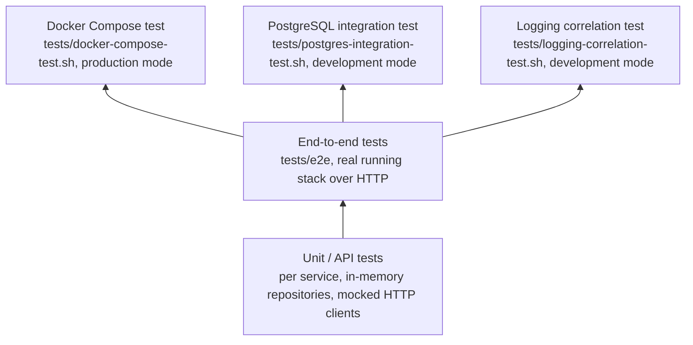

# Testing

## 1. Overview

PulseTrace has five test layers. Lower layers are fast and need nothing running; higher layers exercise the real containers and database.



| Layer | Location | Runner | Needs running stack | Needs database |
|---|---|---|---|---|
| Unit / API | `services/<service>/tests/` | `node --test`, Supertest | No | No |
| End-to-end | `tests/e2e/api-flow.test.js` | `node --test` | Yes | Yes (via services) |
| Compose test | `tests/docker-compose-test.sh` | Bash | Yes (Compose stack) | Yes |
| PostgreSQL integration | `tests/postgres-integration-test.sh` | Bash | Starts/recreates it | Yes |
| Logging correlation | `tests/logging-correlation-test.sh` | Bash | Yes (Compose stack) | Yes |

## 2. Unit and API Tests

Each service builds its app with `createApp()` and injects test doubles, so the tests run in-process without ports or containers.

| Service | Files | What they cover |
|---|---|---|
| API Gateway | `tests/api-gateway.api.test.js` | Health, request forwarding (method, headers, body), `404` forwarding, `503`, `504`, unknown routes. Uses a mock `orderClient`. |
| Order Service | `tests/order.api.test.js`, `tests/order.integration.test.js` | Create/get order, validation errors, `PAID`, `PAYMENT_FAILED`, `PENDING` when payment is unavailable. Uses in-memory repository and mock `paymentClient`. |
| Payment Service | `tests/payment.api.test.js` | Create/get payment, simulated failure, validation, `404`, simulation rejected in production. Uses in-memory repository. |

Run:

```bash
# one service
npm test --workspace=@pulsetrace/order-service

# all three
npm test --workspaces
```

The `test` script of each service sets `LOG_LEVEL=silent`, so the tests do not print JSON logs.

These tests do not touch PostgreSQL. Behavior that depends on the database (for example constraints, persistence, and migrations) is covered only by the layers below. Malformed-ID handling (`404` for lookups, `400 INVALID_ORDER_ID`) is checked in these unit tests because the services validate the UUID format before reaching the repository.

## 3. End-to-End Tests

`tests/e2e/api-flow.test.js` calls the running system over HTTP.

Checks: all three `/health` endpoints, successful order with payment (`PAID`), retrieval through the Gateway, failed payment (`PAYMENT_FAILED`), invalid amount (`400 INVALID_AMOUNT`), and unknown order (`404 ORDER_NOT_FOUND`, using a valid but nonexistent UUID).

```bash
npm run test:e2e
```

Requirements:

- `NODE_ENV=development` on the services, because the failed-payment case sends `simulateFailure`.
- The health check hits `localhost:3001` and `localhost:3002` directly. Compose does not publish those ports, so this test fits services started with npm. Against the Compose stack, use the scripts below. `GATEWAY_URL` overrides the Gateway address.

## 4. Docker Compose Test

`tests/docker-compose-test.sh` checks the **already running** Compose stack in production mode. It does not start or stop containers.

```bash
export NODE_ENV=production
docker compose up -d --build
./tests/docker-compose-test.sh
```

| # | Check |
|---|---|
| 1 | `docker compose config` is valid |
| 2-4 | `payment-service`, `order-service`, `api-gateway` containers are `healthy` |
| 5 | Gateway `/health` returns `200` |
| 6 | Order Service reaches `payment-service:3002` by DNS |
| 7 | Gateway reaches `order-service:3001` by DNS |
| 8 | End-to-end order creation returns `201` and `PAID` |
| 9 | The created order can be retrieved |
| 10 | `simulateFailure` is rejected with `400 SIMULATION_NOT_ALLOWED` |

The script exits with an error unless `NODE_ENV=production`. It needs `docker`, `curl`, and `node`.

## 5. PostgreSQL Integration Test

`tests/postgres-integration-test.sh` verifies persistence. It forces `NODE_ENV=development`, ensures PostgreSQL is running, and force-recreates the three application containers.

```bash
./tests/postgres-integration-test.sh
```

| # | Check |
|---|---|
| 1 | Compose configuration is valid |
| 2 | PostgreSQL is healthy |
| 3-5 | Payment, Order, Gateway containers are healthy |
| 6 | PostgreSQL accepts queries |
| 7-8 | `order_db` and `payment_db` exist |
| 9-10 | `schema_migrations` exists in both databases |
| 11 | Gateway `/health` returns `200` |
| 12 | Successful order is created with `PAID` |
| 13 | The order can be retrieved with `PAID` |
| 14-15 | The order row and the `SUCCEEDED` payment row exist in the databases |
| 16 | Simulated failure produces `PAYMENT_FAILED` |
| 17-18 | The failed order and `FAILED` payment rows exist |
| 19 | Invalid amount is rejected with `400` (or `422`) |
| 20 | Order and Payment services recover after `docker compose restart` |
| 21-22 | The order is still retrievable and still in the database after the restart |

Needs `docker`, `curl`, and `jq`. Set `BASE_URL` to test a Gateway on another address.

## 6. Logging Correlation Test

`tests/logging-correlation-test.sh` verifies structured logging and request ID propagation on the **already running** stack. Unlike the PostgreSQL test it does not recreate containers, so the stack must already run with `NODE_ENV=development` (the failed-payment check sends `simulateFailure`).

```bash
export NODE_ENV=development
docker compose up -d --build --wait
./tests/logging-correlation-test.sh
```

| # | Check |
|---|---|
| 1 | Compose configuration is valid |
| 2 | Payment, Order, and Gateway containers are healthy |
| 3 | Gateway `/health` returns `200` |
| 4 | A supplied `x-request-id` is returned in the response header |
| 5-7 | The same request ID appears in the logs of the Gateway, Order Service, and Payment Service |
| 8 | The `Payment processed` entry (`SUCCEEDED`) carries the request ID |
| 9 | A UUID is generated and returned when no ID is supplied |
| 10 | An unsafe ID is replaced with a generated UUID |
| 11 | A simulated payment failure is logged (`FAILED`) with its request ID |
| 12 | `/health` requests do not appear in the logs |
| 13 | Request body data (the customer ID) does not appear in any log |

Every run uses unique IDs, and log lines are read from the last 10 minutes, so old entries cannot cause false passes. The script needs `docker`, `curl`, and `jq` (for the failure message). The total number of checks is calculated, so it does not need updating when checks are added. See [Observability](../architecture/observability.md).

## 7. Reports

The three scripts write a Markdown report to `tests/reports/`:

| Script | Report file |
|---|---|
| `docker-compose-test.sh` | `docker-compose-test-<timestamp>.md` |
| `postgres-integration-test.sh` | `postgres-integration-test-<timestamp>.md` |
| `logging-correlation-test.sh` | `logging-correlation-test-<timestamp>.md` |

Each report contains a summary and a per-check result table. All scripts exit non-zero when any check fails, so they can be reused in CI later.

## 8. Choosing a Layer

| Goal | Run |
|---|---|
| Changed validation or business logic | Unit / API tests |
| Changed repository SQL, migrations, init script | PostgreSQL integration test |
| Changed Dockerfile, Compose file, networking, health checks | Docker Compose test |
| Changed logging, request ID handling, or what is written to logs | Logging correlation test |
| Verify the whole flow with services started by npm | End-to-end tests |

## 9. Current Gaps

- The PostgreSQL integration test does not include a malformed-ID check. That behavior is verified by unit tests and was checked manually against the running stack.
- No automated test checks that database error codes are hidden from responses.
- No test covers a payment that succeeds while the following order update fails.
- No automated test covers a hanging Payment Service, which is where the Gateway and payment timeouts interact. It was checked manually by stopping the Payment Service.
- The logging correlation test does not check error log entries (for example the `error` serializer).
- Tests are run manually. CI automation with GitHub Actions is planned.
- The test count (`TOTAL=22`) in the PostgreSQL script is a constant and must be updated when checks are added.
