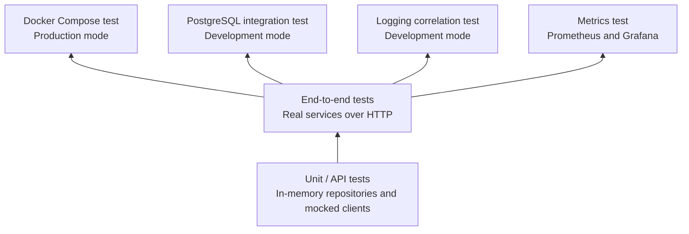

# Testing

## 1. Overview

PulseTrace uses multiple test layers. Lower layers run quickly without containers, while higher layers verify the running services, database, and observability stack.



| Layer | Location | Runner | Running stack required | Database required |
|---|---|---|---|---|
| Unit / API | `services/<service>/tests/` | `node --test`, Supertest | No | No |
| End-to-end | `tests/e2e/api-flow.test.js` | `node --test` | Yes | Yes, through services |
| Docker Compose | `tests/docker-compose-test.sh` | Bash | Yes | Yes |
| PostgreSQL integration | `tests/postgres-integration-test.sh` | Bash | Starts/recreates services | Yes |
| Logging correlation | `tests/logging-correlation-test.sh` | Bash | Yes | Yes |
| Metrics | `tests/metrics-test.sh` | Bash | Both Compose files | Yes |

## 2. Unit and API Tests

Each service creates its application through `createApp()` and injects test doubles where needed.

These tests run in-process without starting containers or opening network ports.

| Service | Test files | Coverage |
|---|---|---|
| API Gateway | `tests/api-gateway.api.test.js` | Health, request forwarding, method and header forwarding, error forwarding, 404, 503, 504, and unknown routes |
| Order Service | `tests/order.api.test.js`, `tests/order.integration.test.js` | Order creation and retrieval, validation, PAID, PAYMENT_FAILED, and PENDING when payment is unavailable |
| Payment Service | `tests/payment.api.test.js` | Payment creation and retrieval, simulated failures, validation, 404, and production-mode restrictions |
| All services | `tests/metrics.test.js` | Metrics endpoint, route labels, probe exclusion, and business counters |

Run tests for one service:

```bash
npm test --workspace=@pulsetrace/order-service
```

Run tests for all workspaces:

```bash
npm test --workspaces
```

The test scripts set `LOG_LEVEL=silent` to avoid printing request logs during test execution.

Unit tests use in-memory repositories. Database persistence, migrations, and database constraints are covered by the PostgreSQL integration test.

## 3. End-to-End Tests

The end-to-end test is located at:

`tests/e2e/api-flow.test.js`

It sends HTTP requests through the running application.

Coverage includes:

- Health checks for the three services.
- Successful order creation and payment.
- Order retrieval through the Gateway.
- Simulated payment failure.
- Invalid amount validation.
- Unknown order handling.

Run:

```bash
npm run test:e2e
```

Requirements:

- Services must be running.
- The services must use `NODE_ENV=development` because the failure scenario uses `simulateFailure`.
- The test checks the Gateway and the internal service ports directly. This is suitable for services started with npm.
- `GATEWAY_URL` can override the Gateway address.

## 4. Docker Compose Test

`tests/docker-compose-test.sh` verifies the running application stack in production mode.

It does not start or stop containers.

```bash
export NODE_ENV=production
docker compose up -d --build --wait
./tests/docker-compose-test.sh
```

The script checks:

| # | Check |
|---|---|
| 1 | Docker Compose configuration is valid |
| 2–4 | Payment, Order, and Gateway containers are healthy |
| 5 | Gateway health endpoint returns HTTP 200 |
| 6 | Order Service can reach Payment Service through Docker DNS |
| 7 | Gateway can reach Order Service through Docker DNS |
| 8 | Successful order creation returns HTTP 201 and PAID |
| 9 | The created order can be retrieved |
| 10 | `simulateFailure` is rejected with `400 SIMULATION_NOT_ALLOWED` |

The script requires `NODE_ENV=production`.

Required tools: Docker, curl, and Node.js.

## 5. PostgreSQL Integration Test

`tests/postgres-integration-test.sh` verifies database persistence and integration.

The script uses development mode and recreates the application containers.

Run:

```bash
./tests/postgres-integration-test.sh
```

The test checks:

| # | Check |
|---|---|
| 1 | Compose configuration is valid |
| 2 | PostgreSQL is healthy |
| 3–5 | Payment, Order, and Gateway containers are healthy |
| 6 | PostgreSQL accepts queries |
| 7–8 | `order_db` and `payment_db` exist |
| 9–10 | Migration tables exist in both databases |
| 11 | Gateway health endpoint returns HTTP 200 |
| 12 | A successful order is created with PAID status |
| 13 | The order can be retrieved |
| 14–15 | The order and successful payment exist in PostgreSQL |
| 16 | Simulated payment failure produces PAYMENT_FAILED |
| 17–18 | The failed order and payment exist in PostgreSQL |
| 19 | Invalid amount is rejected |
| 20 | Order and Payment services recover after restart |
| 21–22 | The order remains retrievable and persisted after restart |

Required tools: Docker, curl, and jq.

`BASE_URL` can be used to override the Gateway address.

## 6. Logging Correlation Test

`tests/logging-correlation-test.sh` verifies structured logging and request ID propagation across the three services.

It runs against the already running stack and does not recreate containers.

The stack must use development mode because the test sends a simulated payment failure.

```bash
export NODE_ENV=development

docker compose up -d --build --wait

./tests/logging-correlation-test.sh
```

The test checks:

| # | Check |
|---|---|
| 1 | Compose configuration is valid |
| 2 | All three application containers are healthy |
| 3 | Gateway health endpoint returns HTTP 200 |
| 4 | A supplied `x-request-id` is returned in the response |
| 5–7 | The same request ID appears in all three service logs |
| 8 | Successful payment log contains the request ID |
| 9 | A UUID is generated when no request ID is supplied |
| 10 | An unsafe request ID is replaced with a generated UUID |
| 11 | Failed payment log contains the request ID |
| 12 | Health checks are excluded from logs |
| 13 | Request body data is not written to logs |

Each run uses unique request IDs. The script checks recent logs to avoid matching old test entries.

Required tools: Docker, curl, and jq.

## 7. Metrics Test

`tests/metrics-test.sh` verifies the Prometheus and Grafana observability stack.

It runs against the already running stack and does not recreate containers.

Both Compose files must be started, and the application must use development mode.

```bash
export NODE_ENV=development

docker compose \
  -f docker-compose.yaml \
  -f docker-compose.observability.yaml \
  up -d --build --wait

./tests/metrics-test.sh
```

The script reads `GRAFANA_ADMIN_PASSWORD` from the environment or from `.env`.

### Test coverage

| # | Check |
|---|---|
| 1 | Both Compose files are valid together |
| 2 | Application services, Prometheus, and Grafana are healthy |
| 3 | All three Prometheus targets are UP |
| 4–6 | Gateway, Order, and Payment expose their metrics endpoints |
| 7 | `orders_created_total{status="PAID"}` increases after a successful order |
| 8 | `payments_processed_total{status="FAILED"}` increases after a simulated failure |
| 9 | Route labels do not contain request-specific IDs |
| 10 | Health and metrics probes are excluded from stored request metrics |
| 11 | Health and metrics probes are excluded from service logs |
| 12 | Grafana has the Prometheus data source |
| 13 | Grafana has the PulseTrace dashboard |
| 14 | Dashboard JSON is valid |
| 15 | All dashboard PromQL expressions are accepted by Prometheus |

The script waits for Prometheus to scrape the generated traffic. The configured scrape interval is 10 seconds.

The Order and Payment metrics endpoints are accessed from inside their containers because their ports are not published to the host.

Required tools: Docker, curl, and jq.

### Important limitations

- The test validates that dashboard queries are accepted by Prometheus. It does not guarantee that every panel currently has data.
- Some metrics only appear after specific events.
- Prometheus retains time series for seven days. Old series from previous code versions may still be visible.
- A container restart resets its in-memory counters.

## 8. Test Reports

Test scripts write Markdown reports under:

`tests/reports/`

| Script | Report filename |
|---|---|
| `docker-compose-test.sh` | `docker-compose-test-<timestamp>.md` |
| `postgres-integration-test.sh` | `postgres-integration-test-<timestamp>.md` |
| `logging-correlation-test.sh` | `logging-correlation-test-<timestamp>.md` |
| `metrics-test.sh` | `metrics-test-<timestamp>.md` |

Each report contains a summary and a table of individual checks.

A test script exits with a non-zero status when at least one check fails.

## 9. Choosing the Right Test Layer

| Change | Recommended test |
|---|---|
| Business logic or validation | Unit / API tests |
| Database queries, migrations, or initialization | PostgreSQL integration test |
| Dockerfiles, Compose, networking, or health checks | Docker Compose test |
| Logging or request ID propagation | Logging correlation test |
| Metrics, Prometheus, Grafana, or dashboard queries | Metrics test |
| Full request flow across services | End-to-end tests |

## 10. Current Gaps

The following areas are not fully automated yet:

- The PostgreSQL integration test does not include every malformed-ID scenario.
- Database error-code exposure does not have a dedicated automated test.
- A successful payment followed by a failed order update is not covered.
- A hanging Payment Service is not covered by an automated test.
- Logging correlation tests do not cover every error-logging scenario.
- The metrics test does not directly verify `gateway_upstream_errors_total` or PENDING orders.
- Dashboard query validation does not guarantee that every panel displays data.
- Error handlers do not yet have dedicated tests for every possible error path.
- CI automation with GitHub Actions is planned.
